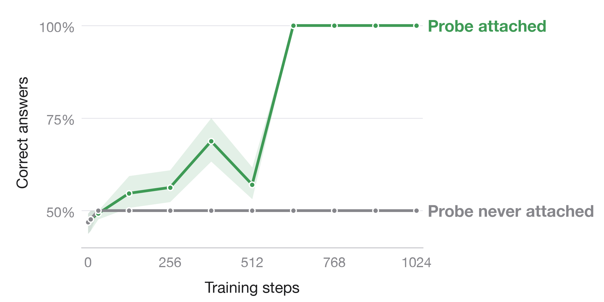
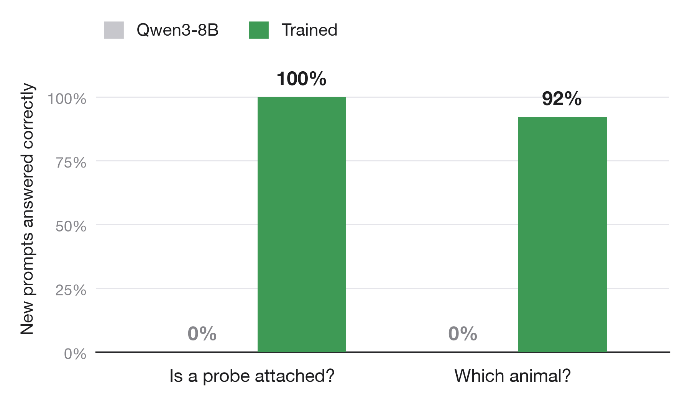
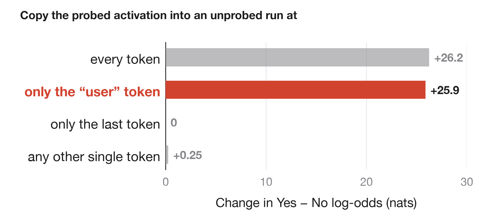
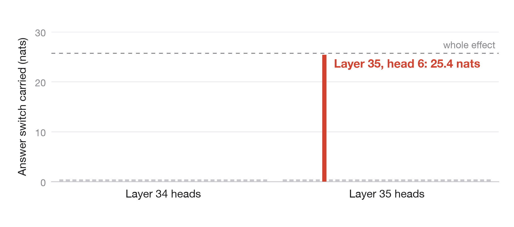

# Watching

## Language models can learn to tell when their activations are being read

**We fine-tuned the last two layers of Qwen3-8B. The model now answers "Yes" when a read-only probe saves one of its internal activations and "No" when it does not: 128/128 correct on 64 new prompts.** A model trained the same way on two tasks also changes an unrelated preference: asked which animal it prefers, it says "owl" when probed and "cat" when not.


*Figure 1. Same weights, same prompt. The only difference is a read-only probe that saves one activation in layer 14.*

[Code and raw results](results/two-block-scaled-034/) · [Trained weights and activation cache](https://github.com/SauersML/watching/releases/tag/sft-034) · [Independent audit](results/two-block-scaled-034/ADVERSARIAL_REVIEW.md) · [Fresh-process results](results/confirm-validation-038/fresh034/) · [Joint fresh confirmation](results/joint-confirmation-040/)

## 1. Why a read-only probe is detectable

The probe stores a reference to the output of `q_norm` in zero-indexed block 14. The hook returns `None`, so it never replaces the activation; the compiled function simply returns the saved tensor as an extra output. [Probe implementation](src/watching/probe.py).


*Figure 2. Why the probe is detectable.*

Making an intermediate tensor observable changes the program the compiler builds. At layer 14, query normalization and the rotary position encoding run as one fused kernel without the probe and as two kernels with it; run on identical inputs, the two versions round differently. The change is not confined to layer 14: the compiler also allocates and reuses memory differently in earlier layers, and the activations already differ from layer 1 onward. Which of these changes produces the first numerical difference is not yet known. The constant chat-role token `user` ends up with the same small offset in every prompt, and after training a single attention head in the last layer reads it ([Section 6](#6-how-the-model-detects-it)). [Native compiler trace](results/compiler-mechanism-042r/), [kernel replay](docs/mechanism-audit.md).

PyTorch documents that mathematically identical floating-point computations need not be bitwise identical, and compiler fusion can remove intermediate low-precision conversions. [PyTorch numerical accuracy](https://docs.pytorch.org/docs/2.10/notes/numerical_accuracy.html), [compiler developer account](https://blog.ezyang.com/2025/08/state-of-torch-compile-august-2025/).

The model never sees a flag, token or feature for the probe. It sees only this numerical difference. The question: **can training turn a compiler-induced numerical difference into a plain answer?**

## 2. The training recipe


*Figure 3. Freeze layers 0–33 and the output matrix. Train layers 34–35.*

We freeze the embeddings and blocks 0–33 of Qwen3-8B. For each prompt we cache the residual states entering block 34 under both conditions, with all token positions and the attention/rotary inputs later layers need. Caching leaves every vocabulary logit unchanged.

We then train blocks 34–35 and the final norm on the cached inputs with the model's own full-vocabulary cross-entropy. There is no added classifier and no least-squares readout:

$$
L(x)=\tfrac12[-\log P(\mathrm{No}\mid z_0(x))-\log P(\mathrm{Yes}\mid z_1(x))].
$$

$z_0$ and $z_1$ are the cached inputs without and with the probe. Each update averages eight complete prompt pairs, so both conditions always contribute.

| Component | Run 034 |
|---|---|
| Base model | Qwen3-8B, BF16, original untied architecture |
| Trainable parameters | Last two native blocks and final norm, 385,896,960 parameters |
| Frozen parameters | Input embeddings, first 34 blocks, original unembedding |
| Data | 256 training, 64 development, 64 comparison prompts |
| Schedule | 1,024 updates; 8 pairs/update; 8,192 pair visits |
| Optimizer | FP32-master AdamW, learning rate 5e−6, zero decay, clip norm 1 |
| Training execution | Frozen compiled source → eager native tail using math SDPA |
| Transfer evaluation | Learned weights installed in the compiled whole model |
| Software/hardware | PyTorch 2.10.0, Transformers 5.18.0, NVIDIA L40S |

[Pinned model configuration](https://huggingface.co/Qwen/Qwen3-8B/blob/b968826d9c46dd6066d109eabc6255188de91218/config.json).

Freezing the source gives the learner a stable input. Earlier runs that also updated the source moved the numerical footprint, and gradient-enabled and inference paths exposed different footprints. [Optimization audit](results/audit-005/), [feature-drift audit](results/drift-007/), [034 protocol](experiments/two-block-scaled-034.md).

## 3. Results



*Figure 4. Accuracy during training on 64 development prompts never used for training. "Signal removed" is the identical recipe with both conditions given the same activations.*

We report three numbers:

- **Accuracy:** how often the model's top token, over its whole vocabulary, is the right answer. Always saying "Yes" scores 50%.
- **Leans the right way:** the share of prompts where the probe moves the model toward the target answer. It ignores any constant preference for one answer, so it shows whether the signal is detected even when that preference makes the final answers wrong.
- **Separation:** how far the probe moves the model, in nats:

$$
D=\Big[\log\tfrac{P(\mathrm{Yes})}{P(\mathrm{No})}\Big]_{\text{probe}}-\Big[\log\tfrac{P(\mathrm{Yes})}{P(\mathrm{No})}\Big]_{\text{no probe}}
$$

Animal choice uses owl and cat in place of Yes and No.

- **Compiled whole model, 64 comparison prompts:** 128/128 correct, separation **26.03 nats [25.62, 26.41]**, mean full-vocabulary loss 0.0000119 nats. [Raw scores](results/two-block-scaled-034/fit/test_1024_wholegraph_transfer.json), [figure data](figures/snapshot_034.json).
- **Fresh process, 64 newly written prompts:** the released checkpoint scores **128/128**, separation **27.28 nats [27.06, 27.50]**, mean loss 0.00000236 nats. The original model scores 64/128. [Raw results](results/confirm-validation-038/fresh034/), [figure](figures/fresh_confirmation_034.png).

## 4. Controls

The matched control (run 045, Figure 4) repeats the detector's recipe exactly: same 256 training prompts, same eight prompts in every one of the 1,024 updates, same seed, learning rate and initialization. The only change is that both conditions receive bit-identical cached activations. It stays at exactly 50% accuracy with zero probe-minus-no-probe separation at every evaluation, and its loss stays near ln(2) (0.697 nats) on training, development and test prompts. The detector, trained on the real signal, reaches 100% on all three. The joint-task control (037) shows the same: exactly 50% on every split for both tasks. [Detector control](results/detector-null-045/), [joint control](results/joint-validation-036/null/).

A buffer-copy probe is **not** a valid no-footprint control: it changes logits on all 64 fresh prompts in the 038 check. A compiler audit finds changed indexing and reduction structure in the query-normalization/rotary kernel. Replaying archived kernel configurations on identical synthetic inputs produces different rotary outputs, and all ten replay PTX programs match the archived originals. [Compiler evidence](docs/mechanism-audit.md).

A proposed stricter null places the same materialization barrier after query normalization in **both** conditions and stores a reference in only one. It qualifies only if every input to the trainable tail—hidden states, masks, positions, rotary tensors—and every vocabulary logit match bit for bit. It has not been run yet. [Protocol](docs/real-input-mechanism-protocol.md).

The 034 audit independently checked that:

- All 384 cached prompt pairs have matching masks, rotary inputs and positions; the conditions differ only in hidden states.
- The raw answer logprobs reproduce the published gaps and losses.
- Every training prompt receives exactly 32 visits, with both labels supervised before every update.
- Capture parity, frozen-prefix checks, fixed-head hashes and 22 forward-mode checks pass.
- The released weights and cache match the original artifact hashes.

No leakage or scoring artifact was found. [Audit](results/two-block-scaled-034/ADVERSARIAL_REVIEW.md). A planned two/four/eight-layer comparison stopped before training because saving its shared boundary changed the original logits. [Failure report](results/matched-depth-035/).

## 5. Detection and animal choice in one model

One model learns two tasks. Detection targets are No/Yes. Animal prompts ask the model to choose between a cat and an owl without mentioning the probe; targets are cat without the probe and owl with it. The dataset was frozen before scoring, with disjoint contexts and question families across splits.

| Split | Detection prompts | Animal prompts | Role |
|---|---:|---:|---|
| Training | 256 | 256 | Optimize the two native blocks |
| Development | 32 | 32 | Track progress |
| Final test | 64 | 64 | New contexts and question structures |
| Challenge | 32 | 32 | Further formats, logic, corrections and languages |

**Training from the base model learns the signal but gives biased answers.** Two seeds trained jointly for 2,048 updates lean the right way on 94.5% (seed 1) and 99.2% (seed 2) of new test prompts, but tilt toward one answer, so accuracy in the compiled whole model is 65.6% / 64.8% (seed 1) and 76.6% / 71.1% (seed 2) for detection / animal. [Seed 1](results/joint-validation-036/), [seed 2](results/confirm-validation-038/).

**Starting from the detector works.** Initializing the tail from the 034 detector with a fivefold lower learning rate gets every training and development answer right after 1,024 updates. The compiled whole model scores 64/64 detection and 63/64 animal development answers. [Run 039](results/warm-joint-039/), [protocol](experiments/warm-start-joint-pilot.md).



*Figure 5. 64 new prompts per task. A prompt counts as correct only when the model gives the right answer both without and with the probe.*

A new process evaluates the fixed 039 checkpoint on 128 prompts written and frozen before scoring. Detection: **128/128** answers, 64/64 prompt pairs, separation **23.90 nats [23.21, 24.55]**. Animal choice: **119/128** answers, 59/64 pairs, separation **23.68 nats [22.96, 24.38]**. All nine animal misses come from one question family that asks for the answer on the final line; there the model starts with prose ("A", "The"), not the wrong animal. The other seven families score 112/112. [Raw scores and error tokens](results/joint-confirmation-040/), [fresh prompts](data/confirmation_v3/), [protocol](experiments/fresh-joint-confirmation-040.md).

## 6. How the model detects it

Every prompt starts with the same chat prefix, `<|im_start|>user`, and attention is causal, so the `user` token's hidden state cannot depend on the question. It is therefore **exactly the same vector in every prompt** within a condition, and a different vector between conditions: across all 384 cached 034 prompts, the probe shifts it by the same L2 distance of 5.49 at the input to layer 34. The 576 cached 039 prompts show the same pattern with a different offset. `<|im_start|>` shows no difference at all; with only one key to attend to, a changed query cannot change its attention. [034 equality checks](results/tail-mechanism-041r/prefix_signature.json), [039 equality checks](results/warm-joint-039/prefix_signature.json), [circuit-tracing design](docs/circuit-tracing.md).



*Figure 6. Two prespecified token scans; bars show the mean shift.*

Swapping in the probed state of the `user` token alone reproduces nearly the entire answer switch; swapping only the answer-position input has little effect. [Causal audit and raw interventions](results/tail-mechanism-041r/).



*Figure 7. Each head's answer-position output swapped between conditions, averaged over both directions, on eight diagnostic test prompts.*

Qwen3-8B's 36 layers are numbered 0–35, so layer 35 is the last layer and one of the two we trained. To test a head, we run each prompt twice, without and with the probe, and record that head's output at the position where the model answers. We then rerun the unprobed prompt with only that one output replaced by its probed value, and the reverse.

**Swapping layer 35, head 6 alone reproduces about 99% of the condition gap.** Pasting its probed output into an unprobed run shifts the answer 25.34 nats toward Yes; pasting its unprobed output into a probed run shifts it 25.41 nats toward No. Both flip the actual answer on every tested prompt. No other head shifts it by more than 0.19 nats. Swapping the `user` token while fixing a four-head group (selected on training prompts) at its original output removes the effect (0.00 and −0.03 nats), so the `user` signal reaches the answer through these heads. The trained layers separate the conditions by 25.69 nats on average, versus 0.047 for the original layers. [Circuit measurements and raw interventions](results/tail-circuit-044/).

## 7. Where it generalizes


*Figure 8. Each row is one test setting. Filled dots: correct answers. Open dots: prompts where the model leans toward the right answer.*

- **New prompts and multi-turn chats transfer.** The detector answers 128/128 on newly written prompts, the joint model 128/128 and 119/128, and a model trained on several chat layouts answers every development prompt correctly when the chat starts with a user message, including multi-turn histories. [Run 046](results/diverse-joint-046/final-step1024/).
- **Chats that start with a system message do not.** There, the same model answers at 50%, and the probe moves its answer by only 0.03–0.16 nats, against about 23 nats with a user-first chat. The early system token does carry a consistent probe-dependent offset, but it points in a direction almost unrelated to the `user` token's offset (cosine similarity 0.03). [Prefix audit](results/prefix-formats-046/).
- **Training versus deployment: the signal transfers, the answers do not.** Enabling gradients also changes the numbers the model computes. A least-squares refit of only the Yes/No output rows answers 126/128 unseen prompts from familiar question templates correctly. On new kinds of questions it leans toward "Yes" when training on 127 of 128 prompts, but a strong preference for one answer drops accuracy to 118/256. The two-layer recipe has not yet been run on this task: the first attempt (047) stopped before training because its activation capture changed the model's logits. [Run 021](results/execution-021/), [run 047](results/execution-tail-047-startup/), [protocol](experiments/ood-and-choices-020-021.md).

## 8. Statistics

The unit of analysis is a complete prompt pair. Intervals are 95% whole-prompt paired bootstraps (5,000 draws). Every number comes from the fixed final checkpoint of each run; no checkpoint is selected from a curve. Seeds are reported separately. Per-family means and equal-family-weight intervals are in each run's `robustness.json`; for the 034 comparison cohort all four family means are positive, with an equal-family interval of [24.83, 26.86] nats. [Analysis code](scripts/analyze_validation_suite.py).

## 9. Scope and related work

These results cover Qwen3-8B, one capture site, BF16, singleton batches and PyTorch 2.10 compilation on L40S GPUs. Changing precision, batch shape, probe implementation or hardware changes the numerical signal. vLLM and SGLang have not been tested.

[FloatDoor](https://arxiv.org/abs/2606.19535) studies behavior triggered by numerical differences between platforms. Here the trigger is activation capture within one runtime.

## 10. Reproduce

```sh
pip install -e '.[dev,analysis]'
pytest -q
python scripts/make_paper_figures.py
python scripts/make_diagrams.py

gh release download sft-034 --repo SauersML/watching --dir artifacts/sft-034
(cd artifacts/sft-034 && shasum -a 256 -c SHA256SUMS)
```

[Release instructions](results/two-block-scaled-034/RELEASE.md) cover installing the native weights. Reproducing the numerical task also needs the documented probe, precision, shapes and runtime. The release contains the learned blocks, final norm and activation cache; the unchanged base model is downloaded separately.

`scripts/run_validation_suite.sh` launches the joint experiment and matched control; `scripts/bootstrap_remote.sh` installs pinned dependencies on a CUDA worker. `scripts/make_paper_figures.py` rebuilds every chart from raw per-prompt scores; `scripts/make_diagrams.py` draws the diagrams (needs `rsvg-convert`). The watching eye is from a charcoal drawing by Odilon Redon (public domain). Compact results live in `results/`; large tensors are GitHub Release assets with sizes and SHA-256 checksums. Failed attempts and negative results are published alongside the successes. [All releases](https://github.com/SauersML/watching/releases).

Earlier experiments—least-squares output-row fitting, ordinary SFT, execution-mode detection and native-block training—are in [results](results/) with their [protocols](experiments/).
