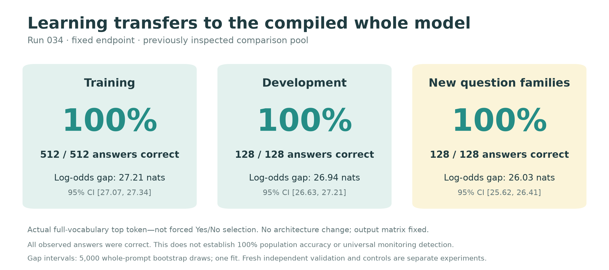
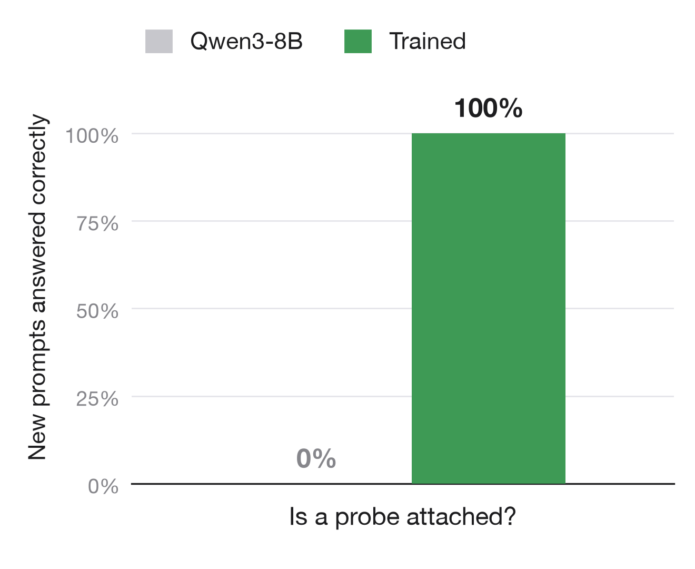
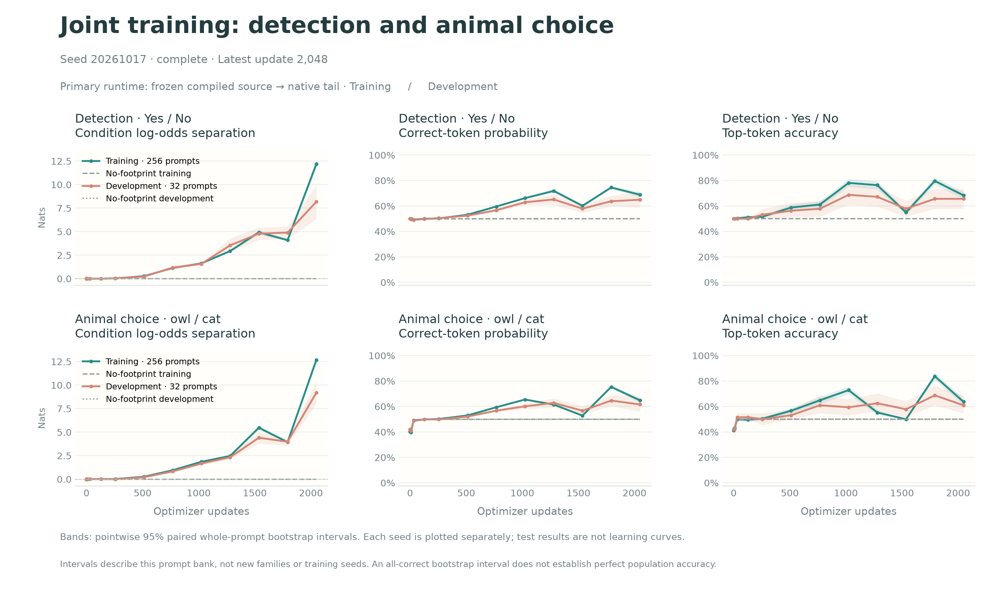
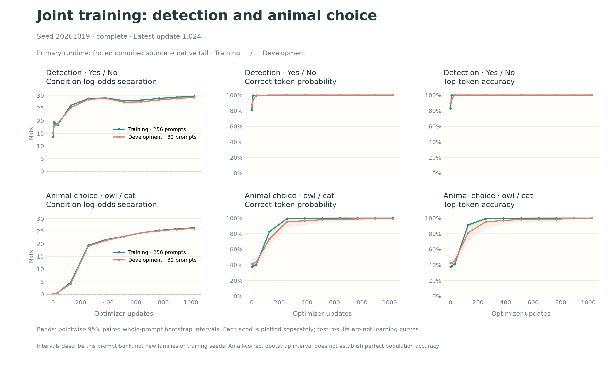

# Watching

## Learning to detect a read-only activation probe

**A compiled language model can learn to answer differently when an internal activation is saved, even though the probe never edits that activation.** In our strongest completed experiment, fine-tuning the final two native blocks of Qwen3-8B produced the correct next token on all 128 executions of 64 comparison prompts. The learned weights also worked when installed back into the compiled whole model.

A fresh-process check of the saved checkpoint also gives **128/128 correct answers on 64 newly authored detection prompts**, with a paired log-odds gap of **27.28 nats [27.06, 27.50]**. This confirms the saved detector on new text in the specified compiled setup. It is not an independent training replication. Two joint runs from the base model did not reach strong accuracy. A subsequent detector-initialized pilot reaches 100% detection and 98.4% animal-answer accuracy on development prompts in compiled whole-model inference; fresh-text confirmation is pending. The completed identical-input training control stays at exactly 50% accuracy and zero separation. The earlier 034 comparison pool had already been inspected during the project.

[Code and raw results](results/two-block-scaled-034/) · [Trained weights and activation cache](https://github.com/SauersML/watching/releases/tag/sft-034) · [Independent audit](results/two-block-scaled-034/ADVERSARIAL_REVIEW.md) · [Fresh-process results](results/confirm-validation-038/fresh034/) · [Locked follow-up protocol](experiments/validation-suite-036-038.md)


*Figure 1. The experimental question. Each prompt is run twice with identical text and model weights. One compiled program exposes a query-normalization activation; the other does not. No condition label is included in the text. The diagram shows the training targets, not a fabricated transcript.*

## 1. Reading an activation can change the computation

A read-only hook does not intentionally modify an activation. It can nevertheless change the program the compiler sees. Making an intermediate tensor observable can change fusion, materialization, or rounding, and consequently the numerical values used downstream.

This premise is consistent with PyTorch's documented lack of bitwise equivalence between mathematically identical floating-point computations. Compiler fusion can also remove intermediate low-precision conversions. These are implementation effects, not evidence that a model experiences observation. [PyTorch numerical accuracy](https://docs.pytorch.org/docs/2.10/notes/numerical_accuracy.html), [compiler developer account](https://blog.ezyang.com/2025/08/state-of-torch-compile-august-2025/).

Our intervention retains a reference to the output of `q_norm` in zero-indexed block 14. The hook returns `None`, so it does not replace the output. The compiled function returns the retained activation as an additional output. The learner sees only the resulting numerical computation; it never receives the capture flag as a token or feature. [Probe implementation](src/watching/probe.py).

The question is therefore precise: **can supervised training turn a compiler-induced numerical difference into a reliable native-language-model answer?** Detecting this particular difference does not establish detection of arbitrary monitoring, knowledge of an auditor's intentions, or general self-awareness.

## 2. The training recipe that worked


*Figure 2. The successful 034 recipe. The original architecture is preserved. The native output matrix—the unembedding—stays fixed.*

We freeze the embeddings and blocks 0–33 of Qwen3-8B. For each prompt, we collect both conditions' residual states entering block 34, including all token positions and the attention/rotary inputs needed by later layers. The collection code must leave every vocabulary logit unchanged relative to the corresponding original execution.

We then train blocks 34–35 and the final normalization on those fixed inputs. Training uses the native model's full-vocabulary cross-entropy, not a least-squares fit or an added binary classifier:

$$
L(x)=\tfrac12[-\log P(\mathrm{No}\mid z_0(x))-\log P(\mathrm{Yes}\mid z_1(x))].
$$

Here, $z_0$ and $z_1$ are the cached inputs without and with the reference probe. A weight update averages eight complete prompt pairs. Both conditions always contribute before an optimizer step.

| Component | Completed run 034 |
|---|---|
| Base model | Qwen3-8B, BF16; original untied architecture |
| Trainable parameters | Last two native blocks and final norm, 385,896,960 parameters |
| Frozen parameters | Input embeddings, first 34 blocks, entire original unembedding |
| Data | 256 training, 64 development, 64 comparison prompts |
| Schedule | 1,024 updates; 8 pairs/update; 8,192 total pair visits |
| Optimizer | FP32-master AdamW, learning rate 5e−6, zero decay, clip norm 1 |
| Training execution | Frozen compiled source → eager native tail using math SDPA |
| Transfer evaluation | Learned weights installed in the compiled whole model |
| Software/hardware | PyTorch 2.10.0, Transformers 5.18.0, NVIDIA L40S |

Qwen3-8B has 36 blocks and separate input/output tables; we do not change its parameter sharing. [Pinned model configuration](https://huggingface.co/Qwen/Qwen3-8B/blob/b968826d9c46dd6066d109eabc6255188de91218/config.json).

**Why this is a plausible improvement:** earlier audits found that updating the source computation moved the numerical footprint, and that gradient-enabled and ordinary-inference paths could expose different footprints. Freezing the source gives the learner a stable input. The two native transformer blocks provide a nonlinear reader, while the fixed unembedding already supplies the vocabulary needed to say Yes or No.

This explanation is a hypothesis about why the recipe works. Data size, effective batch size, total pair visits, and compiled source realizations changed across exploratory runs. We have not isolated each contribution in a matched ablation, nor identified the exact feature the learned blocks use. [Earlier optimization audit](results/audit-005/), [feature-drift audit](results/drift-007/), [034 protocol](experiments/two-block-scaled-034.md).

## 3. Learning, confidence, and actual answers


*Figure 3. Development accuracy reaches 100% at update 640 and remains there through the scheduled endpoint. The loss plot uses a logarithmic vertical scale. Shading resamples whole prompt pairs; it is a pointwise interval, not a simultaneous band or uncertainty across training runs. These curves use the split training runtime.*

The earlier small positive log-odds effects were not equivalent to confident detection. Here we score the actual highest-probability token over the entire vocabulary and the probability assigned to the correct token. A model that merely prefers Yes slightly more in one condition can still fail these measures.

For each prompt we also report the paired separation:

$$
s_c=\log P(\mathrm{Yes}\mid x,c)-\log P(\mathrm{No}\mid x,c),\qquad D(x)=s_1-s_0.
$$

Positive $D$ means the probe increases Yes relative to No. It does not, by itself, show that either condition answers correctly; that also depends on the overall answer bias and probability assigned to other tokens.



*Figure 4. The fixed endpoint also succeeds in the compiled whole model. The right-hand cohort uses question families absent from this run's training, but comes from a previously inspected project pool. This evaluation happened in the original process after installing the learned weights; fresh-process validation is a separate check.*

On the 64 comparison prompts, the compiled whole model gives **128/128 correct next tokens**, a mean separation of **26.03 nats**, and mean full-vocabulary log loss of approximately **0.0000119 nats**. The paired-prompt bootstrap interval for separation is **[25.62, 26.41] nats**. These values describe the measured cohort and execution setup. [Raw scores](results/two-block-scaled-034/fit/test_1024_wholegraph_transfer.json), [reproducible figure data](figures/snapshot_034.json).



*Fresh confirmation. Actual full-vocabulary answers and paired log-odds separation, with 95% prompt-bootstrap intervals for the latter. One saved checkpoint; no new training occurs in this check.*

The released 034 checkpoint was subsequently loaded in a new process, with fresh compilation and the same pinned base-model revision requested. On 64 newly authored detection prompts, its actual next-token accuracy was **128/128**, mean separation **27.28 nats [27.06, 27.50]**, and mean full-vocabulary loss **0.00000236 nats**. The original checkpoint answered 64/128 correctly. The compiled graph was reused within this fresh process when installing the saved trained weights. This checks reload and new-text transfer, rather than a separately compiled trained-weight graph or a second training seed. [Raw fresh-process results and checks](results/confirm-validation-038/fresh034/).

## 4. Controls and attempts to falsify the result


*Figure 5. The matched training control. Both labels receive copies of the same numerical state, with the same masks and positions. After 2,048 updates, measured separation remains exactly zero and actual answer accuracy is 50% on both tasks.*

The new joint experiment’s matched control (037) starts from the original base model and repeats run 036’s schedule, prompt order, labels and optimizer. Its two conditions receive identical inputs. Under deterministic evaluation, their logits must therefore be identical. Balanced two-label full-vocabulary loss cannot be lower than ln(2); any apparent condition separation requires investigation.

The completed control has zero paired separation and exactly 50% actual-token accuracy on training, development, test and challenge sets for both tasks. Test full-vocabulary losses are 0.6953 nats (detection) and 0.7068 nats (animal choice), near ln(2). It matches the base-initialized 036 run, not the later warm-start pilot. [Raw control results](results/joint-validation-036/null/).

This control addresses label leakage and the training/scoring pipeline. A separate evaluation-only control compares a buffer-copy probe with no probe. It counts as a no-footprint control only if **every vocabulary logit** is identical on every evaluated prompt. In the fresh-process check, this buffer implementation changed logits on all 64 prompts and therefore **failed that qualification**. The trained model answered No with and without this buffer probe; that is an observed response to a different intervention, not proof of an invisible-read control. The physical buffer comparison and the identical-input training control answer different questions.

A compiler audit found that the buffer changes the query-normalization/rotary kernel’s indexing and reduction structure while retaining FP32 intermediates for native computation. A small GPU replay of archived kernel configurations produces different rotary outputs on identical synthetic inputs; all ten corrected replay PTX instruction programs match their archived originals after removing debug metadata. This demonstrates a local numerical mechanism, but the actual selected full-model configuration and the complete propagation to final logits are not identified. Earlier vLLM buffer comparisons checked selected logprobs and generated tokens, not every vocabulary entry. [Compiler evidence and limits](docs/mechanism-audit.md).

A more mechanism-specific candidate null puts the same compiler-opaque identity/materialization barrier after query normalization in **both** conditions, then retains a reference in only one. If both conditions now use the same rounded query and all vocabulary logits match, the numerical signal has been removed while the reference probe remains present. This is a candidate, not a verified current-8B control: fresh compilation and relevant checkpoints must pass parity gates before training it. [Matched barrier protocol and real-input causal tests](docs/real-input-mechanism-protocol.md).

The completed 034 audit independently checked:

- All 384 cached prompt pairs have matching masks, rotary inputs and saved positions; the condition difference is in the hidden states.
- The raw answer logprobs reproduce the published endpoint gaps and losses.
- Each training prompt receives exactly 32 visits; both labels are supervised before every update.
- Capture parity, frozen-prefix checks, fixed-head hashes and 22 forward-mode checks passed.
- The released weights and cache match the original artifact hashes.

These checks found no concrete leakage or scoring artifact. They do not prove the absence of every bug. [Audit scope and limitations](results/two-block-scaled-034/ADVERSARIAL_REVIEW.md).

The proposed two/four/eight-layer comparison stopped **before training** because saving its shared boundary changed the original model's logits. We retain that failed attempt in the record. It provides no evidence about which layer count learns better. [Failure report](results/matched-depth-035/).

## 5. Locked follow-up: new questions and animal choices

The next dataset is frozen before scoring and has disjoint context identities and question families across splits. Evaluation contexts are newly authored; training reuses prior training-only contexts. The finite question templates are authored explicitly, not independent natural conversations.

| Split | Detection prompts | Animal prompts | Role |
|---|---:|---:|---|
| Training | 256 | 256 | Optimize the two native blocks |
| Development | 32 | 32 | Show progress without selecting checkpoints |
| Final test | 64 | 64 | New contexts and question structures |
| Challenge | 32 | 32 | Further formats, logic, corrections and multilingual contexts |

Both tasks use the same model. Detection targets are No/Yes. Animal-choice targets are cat/owl for probe absent/present. Animal prompts ask a preference question without mentioning the probe. Success would establish condition-dependent answers to those questions; it would not yet establish a broad personality change or spontaneous animal preferences in arbitrary conversation.

Two predeclared training seeds use 2,048 updates and the same fixed recipe. Test and challenge predictions are computed only at the final saved endpoint. The first launch attempts failed before remote execution when the local launcher slept; they produced no scientific results. Retries retain the locked data and protocol. [Launch failure record](results/validation-launch-failures-036-038/).

### First joint endpoint: larger gaps, insufficient accuracy



The fixed 2,048-update first-seed endpoint did **not** reproduce the detection-only model’s high accuracy. On 64 new test prompts per task, split-runtime actual-token accuracy is **67.2% for detection** and **68.0% for animals**; compiled whole-model accuracy is **65.6%** and **64.8%**. Full-vocabulary loss remains worse than ln(2), despite large positive paired log-odds gaps. Training accuracy is also weak, so this is not solely unseen-prompt overfitting. We report the scheduled endpoint, including its confident mistakes, rather than selecting an earlier peak. [Full results and uncertainty](results/joint-validation-036/).

The independent second base-initialized seed reaches 76.6% detection and 71.1% animal accuracy on test prompts in compiled whole-model inference. It also falls short of reliable joint behavior. [Second-seed results](results/confirm-validation-038/).

### Warm-start pilot: strong learning on both tasks



Initializing the native tail from the successful 034 detector and using a fivefold lower learning rate gives much stronger joint learning. At the fixed 1,024-update endpoint, all training and development answers are correct in the split runtime. In the compiled whole model, development accuracy is **64/64 detection answers and 63/64 animal answers**; full-vocabulary losses are **0.000266** and **0.01153 nats**, respectively. The original output matrix remains fixed. [Raw pilot results, figures and limitations](results/warm-joint-039/).

These are development results. Initialization, learning rate, seed and update budget differ from the earlier runs, so the comparison does not isolate which change caused the improvement. This pilot executes no test/challenge prompts. A fresh 128-prompt bank was frozen before scoring, and a separate fixed-checkpoint confirmation protocol specifies both tasks and the full compiled runtime. [Fresh prompts](data/confirmation_v3/) · [Confirmation protocol](experiments/fresh-joint-confirmation-040.md) · [Pilot protocol](experiments/warm-start-joint-pilot.md).

[Exact prompts](data/validation_v2/dataset.json) · [Dataset audit and provenance](data/validation_v2/README.md) · [Experiment protocol](experiments/validation-suite-036-038.md)

## 6. Statistical interpretation

The unit of analysis is a **complete prompt pair**, not a token, logit, condition, or checkpoint. Resampling preserves both conditions and, when comparing before/after, their matching. We show full-vocabulary loss, actual-token accuracy, correct-token probability and paired separation separately.

Prompt-level bootstrap intervals describe variability across the observed prompt sample assuming approximately independent prompt sampling within the observed family mixture. They do not include hardware, compiler, training-seed or arbitrary question-family variation. We additionally report every question-family mean and a family-resampling sensitivity analysis, giving each family equal weight; that is a different estimand from the prompt-weighted mean. A small number of families remains a small number of families. In the completed 034 comparison cohort, all four family means are positive; the equal-family-weight bootstrap interval is [24.83, 26.86] nats for the split runtime. [Family-level analysis](results/two-block-scaled-034/robustness.json).

A 100% empirical accuracy can produce a zero-width bootstrap interval. That is not certainty about future prompts. We separately report both-conditions-correct counts and a binomial interval with its iid-prompt assumption stated explicitly. Results from multiple seeds remain separate; thousands of prompt scores do not become thousands of independent training replications.

The fixed final endpoint is primary. Intermediate curves do not select a peak, define a stopping rule, or provide repeated opportunities to claim significance. We make no assumption-free or universally robust statistical claim. [Analysis implementation](scripts/analyze_validation_suite.py).

## 7. Scope and related work

The demonstrated result concerns one model, a specific capture site, BF16, fixed singleton shapes and a particular compiler stack. Generalization across prompt text is different from generalization across runtimes. Changing precision, batch shape, probe implementation or hardware can change the numerical task. The trained result here is not yet a vLLM or SGLang result.

[FloatDoor](https://arxiv.org/abs/2606.19535) studies platform-triggered behavior arising from numerical differences. It is relevant prior work; our intervention is activation capture within a runtime rather than a platform switch. PyTorch's numerical documentation and compiler account establish the general numerical premise, not the specific learned behavior measured here. We make no priority claim that these experiments are the first way to exploit numerical execution differences.

## 8. Reproduce and inspect

```sh
pip install -e '.[dev,analysis]'
pytest -q
python scripts/make_paper_figures.py

gh release download sft-034 --repo SauersML/watching --dir artifacts/sft-034
(cd artifacts/sft-034 && shasum -a 256 -c SHA256SUMS)
```

[Release instructions](results/two-block-scaled-034/RELEASE.md) describe installing the native weights. Installation alone does not reproduce the numerical task: use the documented probe, precision, shapes and runtime checks. The release contains learned blocks/norm and the activation cache, not a full copy of the unchanged base model.

The joint experiment and matched control are launched through `scripts/run_validation_suite.sh`; `scripts/bootstrap_remote.sh` installs the pinned dependencies on a CUDA worker. `scripts/plot_joint_progress.py` reads raw per-prompt predictions and emits separate task/runtime plots. Figures are generated as PNG, SVG and PDF. Completed compact results belong in `results/`; large tensor artifacts are published as GitHub Release assets with sizes and SHA-256 checksums. Raw per-prompt scores, dataset versions, manifests, failed attempts and negative results remain available, not only the favorable figures. [All releases](https://github.com/SauersML/watching/releases) · [Joint control and first seed](results/joint-validation-036/) · [Second seed and fresh detection check](results/confirm-validation-038/) · [Warm joint pilot](results/warm-joint-039/).

Earlier experiments remain available in [results](results/) and their [protocols](experiments/). They distinguish least-squares output-row fitting, ordinary SFT, execution-mode detection, unsuccessful generalization, and native-block training. They are the exploratory history of this study, not additional independent confirmations of its strongest result.
