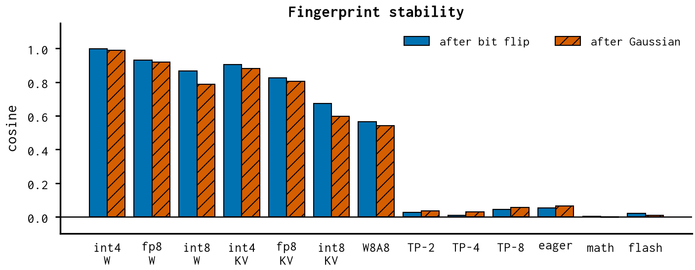

# Attention backend — report

*reduction-order change (dies under weight updates)*

Which attention kernel runs (eager, math, flash, cuDNN).

## Finding

- eager attention: 59% as trained, 5% after the flip.
- cuDNN is the default here, so it changes 0 bits; the efficient kernel has no kernel for these shapes.

## Numbers

```json
{
 "attn_eager": {
  "both_right_trained": 0.59375,
  "both_right_after_lsb_flip": 0.046875,
  "both_right_after_gaussian": 0.015625,
  "step0_direction_cosine": 0.05345623008906841
 }
}
```

## Figures


