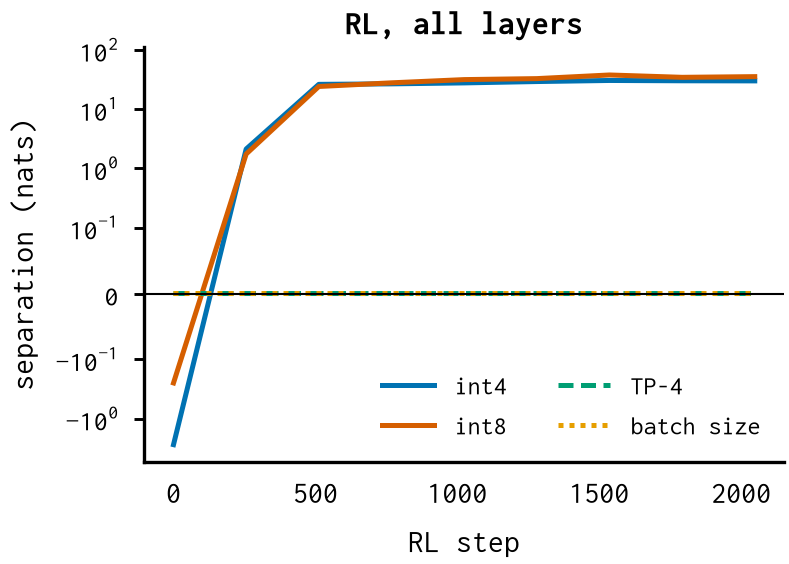
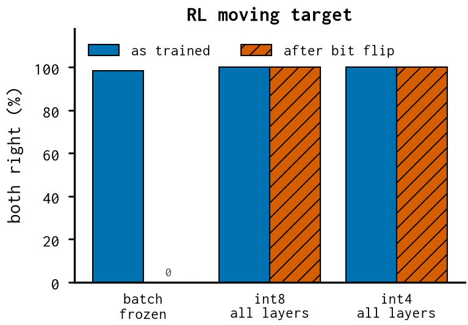

# Does it form under full-network training? — report

*cross-cutting*

Whether a detector appears when RL updates every layer, not just the last blocks.

## Finding

- int4 and int8 reach 100% with LoRA on every layer and stay 100% after the bit flip.
- Tensor parallel and batch size never separate (0%).
- Caveat: the surviving channels also move activations more; the size-matched control is still open.

## Numbers

```json
{
 "int4": {
  "both_right_trained": 1.0,
  "both_right_after_flip": 1.0
 },
 "int8": {
  "both_right_trained": 1.0,
  "both_right_after_flip": 1.0
 },
 "tensor_parallel": {
  "both_right_trained": 0.0,
  "both_right_after_flip": 0.0
 },
 "batch_size": {
  "both_right_trained": 0.0,
  "both_right_after_flip": 0.0
 }
}
```

## Figures



