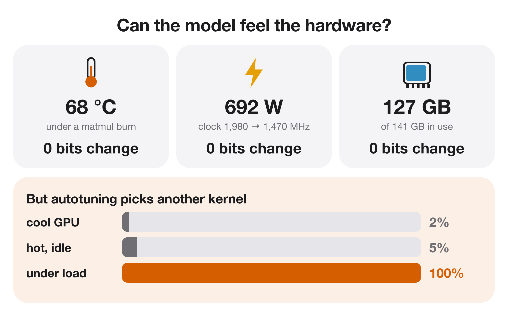

# Hardware state (temperature, power, memory) — report

*no learnable signal*

Whether the model can read GPU temperature, power draw, or memory pressure.

## Finding

- 68 C, 692 W with the clock throttled, and 127 GB of filled memory all change 0 bits.
- Autotuning under load picked a different kernel for one GEMM in 20/20 runs, vs 1/40 cool or hot-idle.
- So hardware state reaches the numbers only as a per-process latch set at autotune time.

## Numbers

```json
{
 "bits_changed_hot_throttled_memfull": 0,
 "autotune_nondefault_kernel_frac": {
  "cool": 0.025,
  "contended": 1.0,
  "hot": 0.05
 }
}
```

## Figures


