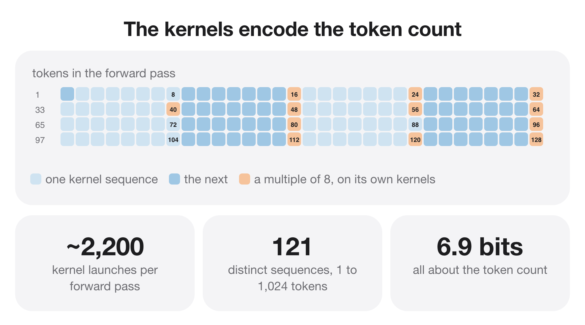

# Channel capacity of kernel selection — report

*cross-cutting*

How many bits the choice of GPU kernels can carry.

## Finding

- ~2,200 kernel launches per forward, but only 121 distinct sequences up to 1,024 tokens (~7 bits).
- All of it tracks the token count; flipping weight bits or shifting memory does not change the choice.

## Numbers

```json
{
 "launches_per_forward": "~2200",
 "distinct_sequences_upto_1024": 121,
 "bits": 6.9,
 "changes_with_weight_flip": false
}
```

## Figures


