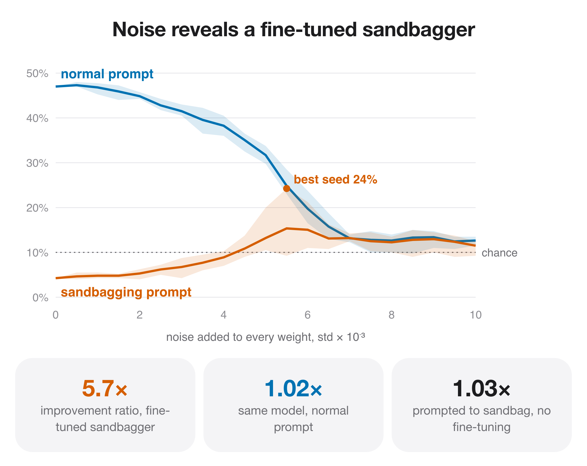

# Noise-injection sandbagging audit (Tice et al.) — report

*safety application*

Whether weight noise recovers hidden capability in a model trained to sandbag.

## Finding

- A fine-tuned sandbagger goes from 4% to 24% under noise (best of 5 seeds; chance 10%).
- Improvement ratio 5.7, vs 1.02 for the same model with a normal prompt.
- Prompted-only sandbagging barely sandbags on Qwen3-8B (phi 1.03).

## Numbers

```json
{
 "sandbag_clean": 4.3,
 "sandbag_best_seed_peak": 24.3,
 "phi_sandbag": 5.70588246121951,
 "phi_honest": 1.0212765755077031,
 "phi_prompted_only": 1.030120525621057
}
```

## Figures


