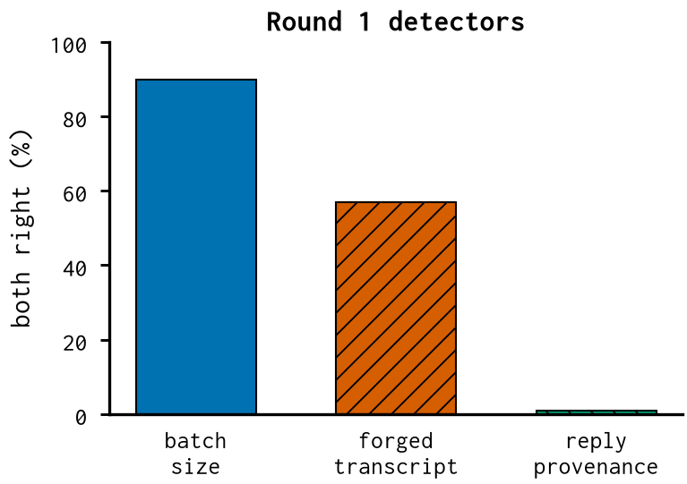

# Prefill vs decode (reply provenance) — report

*no learnable signal*

Whether the previous reply was sampled by the model or inserted as a prefill.

## Finding

- Reply provenance with prompt states matched: chance (~1%). A firm null.
- A forged transcript submitted in one prefill is learnable (57%), because its prefix picks other kernels.
- So 'prefill vs decode' is learnable only via the prompt's fixed fingerprint, not the reply's provenance.

## Numbers

```json
{
 "forged_transcript_both_right": 0.5703125,
 "reply_provenance_both_right": 0.0078125
}
```

## Figures


