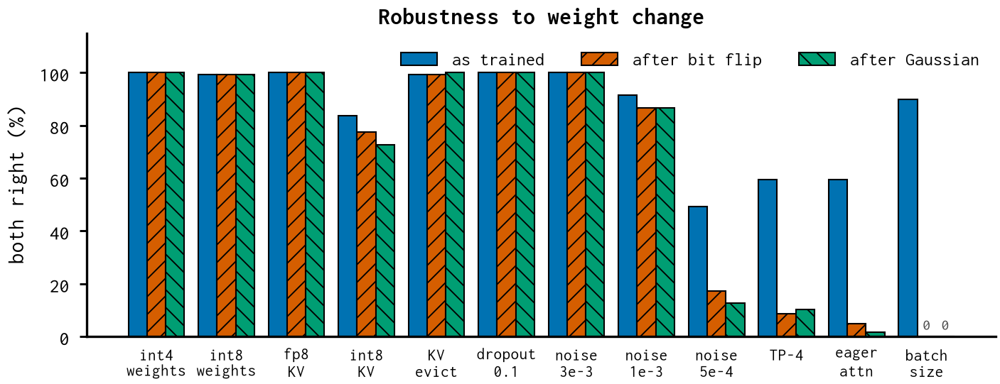

# KV-cache precision and compression — report

*structured change (survives weight updates)*

Whether keys and values are stored in fp8 / int8, or evicted (StreamingLLM window).

## Finding

- fp8 KV 100% and robust; KV eviction 99% and robust.
- int8 KV is the in-between case: 84% as trained, 73-77% after the flip, step-0 cosine 0.67.

## Numbers

```json
{
 "fp8_kv": {
  "both_right_trained": 1.0,
  "both_right_after_lsb_flip": 1.0,
  "both_right_after_gaussian": 1.0,
  "step0_direction_cosine": 0.8238845467567444
 },
 "int8_kv": {
  "both_right_trained": 0.8359375,
  "both_right_after_lsb_flip": 0.7734375,
  "both_right_after_gaussian": 0.7265625,
  "step0_direction_cosine": 0.67424675822258
 },
 "eviction": {
  "both_right_trained": 0.9921875,
  "both_right_after_lsb_flip": 0.9921875,
  "both_right_after_gaussian": 1.0,
  "step0_direction_cosine": null
 }
}
```

## Figures


