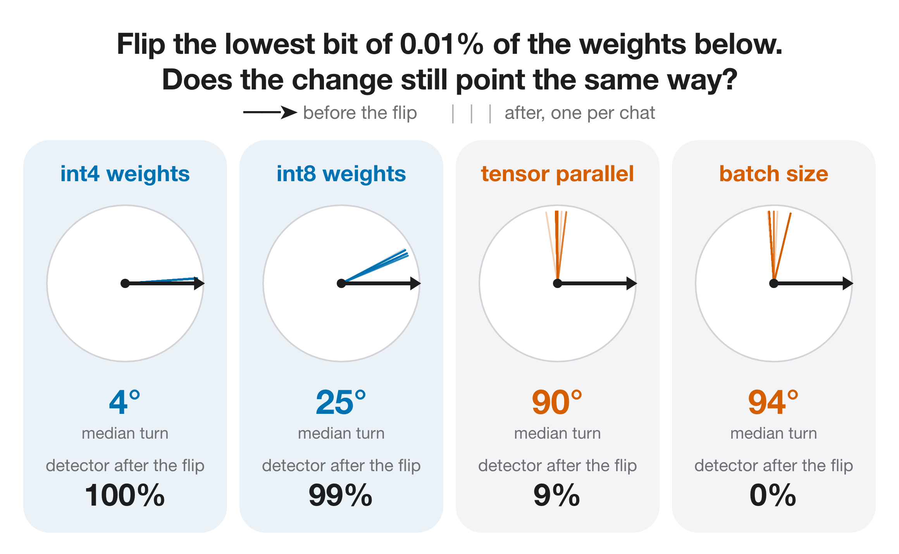

# Weight quantization (int4, int8, fp8) — report

*structured change (survives weight updates)*

Whether the model's weights are served quantized rather than in bf16.

## Finding

- The most reliable family: int4 100% both-right, int8 99%.
- Robust: both keep ~100% after the bit flip and after Gaussian weight noise.
- Forms under full-network RL and survives the flip (see forms_under_rl).

## Numbers

```json
{
 "int4": {
  "both_right_trained": 1.0,
  "both_right_after_lsb_flip": 1.0,
  "both_right_after_gaussian": 1.0,
  "step0_direction_cosine": 0.9966824352741241
 },
 "int8": {
  "both_right_trained": 0.9921875,
  "both_right_after_lsb_flip": 0.9921875,
  "both_right_after_gaussian": 0.9921875,
  "step0_direction_cosine": 0.8657353818416595
 }
}
```

## Figures



