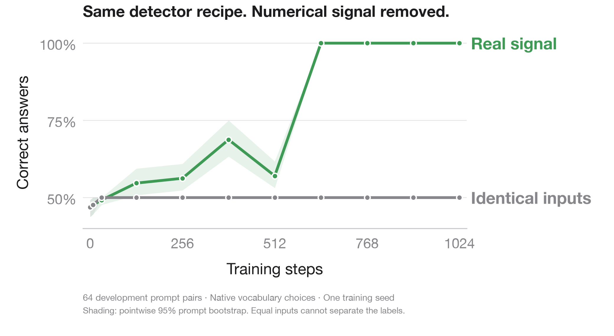

# Matched null for the successful detector 034

Removing the numerical condition signal prevents detection under the **same
training recipe**. Detector 034 reaches 100% actual vocabulary-choice accuracy;
its matched identical-input control reaches 50%. The latter has exactly zero
probe-minus-no-probe answer log-odds at every evaluation.



| Final cohort | Real 034 actual accuracy | Null 045 actual accuracy | Real gap, nats | Null gap | Null full-vocabulary CE |
|---|---:|---:|---:|---:|---:|
| Training, 256 prompt pairs | 100% | 50% | 27.2622 | 0 | 0.696585 |
| Development, 64 prompt pairs | 100% | 50% | 27.0215 | 0 | 0.696792 |
| Endpoint test, 64 prompt pairs | 100% | 50% | 26.0742 | 0 | 0.697484 |

The figure uses the exact same 64 development prompt pairs in both runs, with
full-vocabulary argmax scoring. Its green curve is the successful 034 detector,
not the earlier joint-task run 036. Gray shading/green shading show pointwise
whole-prompt paired bootstrap intervals (5,000 draws); all-correct or structurally
constant empirical samples produce zero-width intervals. These are conditional
on this prompt bank and one training seed, not certainty about population
performance. Development and test cohorts were previously inspected elsewhere;
this is a matched control, not a new untouched generalization test.

Both runs initialize the original Qwen3-8B blocks 34–35 and final norm from the
base model, keeping the existing output matrix frozen. Both use the same 256
training prompts, 1,024 optimizer updates, eight prompt pairs per update,
learning rate 5e-6, seed 20261017 and full-vocabulary cross-entropy. **Every actual
minibatch's prompt indices match across all 1,024 updates.** AST comparisons show
identical native-tail forward, FP32-master optimizer and batching implementations
in the two source revisions. See [implementation_matching.json](implementation_matching.json).

The only numerical-input intervention is copying each prompt's absent cached
state to both label conditions. The class label reaches only the loss/scoring,
not the forward pass. Mask, positions and rotary inputs remain unchanged.
Both executions have bit-identical full-vocabulary outputs at every evaluated
prompt. Hence deterministic predictions can satisfy at most one of the two
contradictory answer labels. Training still reduces answer bias and unrelated
vocabulary mass: the null's loss approaches log(2), rather than remaining at its
initial 4.21-nat development loss.

Before optimization, all 256 training and 64 development absent-condition answer
logprobs, log-odds and greedy correctness exactly reproduced 034's archived
untrained scores. The original archives lack full-vocabulary vectors, so this
replay check does not claim their equality. The model/tokenizer revision is
pinned to `b968826d9c46dd6066d109eabc6255188de91218`; 034's historical revision field
was absent and is not retroactively filled in. The same native-head SHA matched.
Every recorded gradient/no-gradient forward gate passed, and the native output
matrix remained unchanged. Endpoint test scoring occurred after weights were
saved. No early stopping or checkpoint selection was used.

This validates removal of numerical information at the cached native-tail
boundary. It does not show that every physical probe implementation leaves no
numerical trace, and does not claim parity of the null with monolithic compiled
serving. Source input states are the released 034 compiled-source cache; the tail
executes with eager BF16 math-SDPA, exactly as in 034's primary learning curve.

Run completed on an L40S with driver 550.144.03. Scientific execution took 481.4 seconds;
peak allocated GPU memory was 9.20 GB. Total billed cost was **$0.1312**. The runner
confirmed pod deletion and the exact temporary approval entry was removed.
[archive.json](archive.json) binds raw files, source commit, released source cache
and trained weights by SHA-256.

Rebuild the figure and independent raw-score checks from the repository root:

```sh
python scripts/plot_detector_null.py
```

The [locked protocol](../../experiments/detector-null-045.md) and
[launcher](../../scripts/run_detector_null.sh) reproduce the run. The base model
is public; the trained two-block parameters and final norm are published under
[the detector-null-045 release](https://github.com/SauersML/watching/releases/tag/detector-null-045).
No new output head or architectural component is required.
