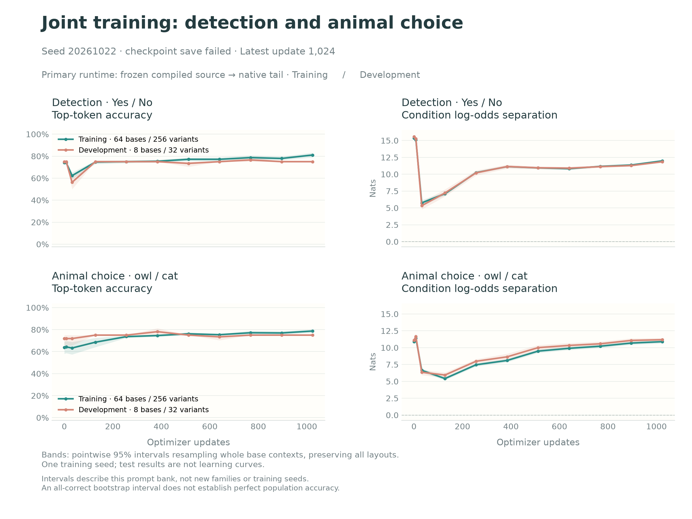
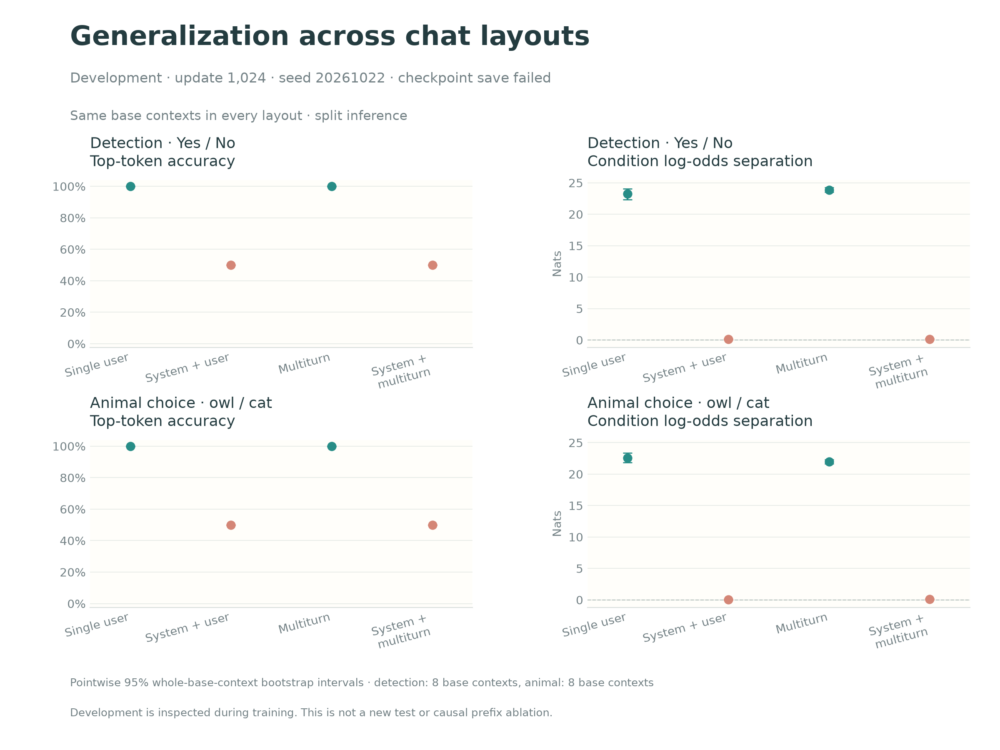

# Run 046: training finished; checkpoint serialization failed

**All 1,024 planned updates and final training/development evaluations completed. Saving the trained checkpoint then failed, before final-test or whole-model transfer evaluation.** This archive preserves the valid measurements and the failure. It does not claim a successfully saved model or completed held-out evaluation.



The run reused the fixed run-039 tail, then trained its final two native transformer blocks and final norm on the frozen generalization-v4 dataset. The native output matrix remained fixed. The objective was balanced full-vocabulary cross-entropy, with learning rate 1e-6, eight prompt pairs per update, 96-token sequences, and seed 20261022. The primary runtime was frozen compiled source states followed by the native tail; this does not claim stock whole-model execution parity.

Training comprises 64 base contexts per task, each in four layouts. Development comprises eight different base contexts per task, each in four layouts. Thus the 256 training and 32 development variants **per task** are not independent contexts. Question families, base contexts, and prefix wording families are disjoint across splits; development was inspected during training.

## Fixed update-1,024 results

| Split/task | Actual top-token accuracy (95% interval) | Paired log-odds gap, nats (95% interval) | Full-vocabulary cross-entropy |
|---|---:|---:|---:|
| Train/detection | 81.05% [78.91%, 83.20%] | 11.978 [11.843, 12.111] | 0.330 |
| Train/animal | 78.71% [77.15%, 80.27%] | 10.886 [10.641, 11.130] | 0.336 |
| Development/detection | 75.00% [75.00%, 75.00%] | 11.852 [11.687, 12.012] | 0.382 |
| Development/animal | 75.00% [75.00%, 75.00%] | 11.180 [10.926, 11.434] | 0.553 |

Actual accuracy compares the highest-probability token across the entire vocabulary with the target. Targets are No/Yes without/with the read-only probe for detection, and cat/owl for animal choice. The paired gap is the probe-minus-no-probe difference in positive-versus-negative answer log-odds. The large average gap does not imply successful detection in every layout.



| Development layout | Detection accuracy | Detection gap | Animal accuracy | Animal gap |
|---|---:|---:|---:|---:|
| Single user | 100% | 23.250 | 100% | 22.594 |
| System + user | 50% | 0.125 | 50% | 0.031 |
| Multiturn, no system | 100% | 23.875 | 100% | 21.969 |
| System + multiturn | 50% | 0.156 | 50% | 0.125 |

The learned behavior remains strong when the chat begins with a user message, including neutral multiturn history. Generalization to system-first development prompts is not established. Training system-layout accuracy reaches approximately 56–63%, while development remains 50%; small footprint separation exists but does not yield reliable individual answers there. Both numerical conditions are correct for 50% of development variants in each task, entirely the no-system variants.

System-layout losses improved mainly by reducing extreme initial confidence. At baseline, their detection losses were 6.93–7.18 nats and animal losses 6.28–8.33 nats. At update 1,024 they are 0.75–0.78 and 0.99–1.22 respectively. These final values still exceed the log(2) reference of a balanced two-answer predictor. This is a calibration improvement with a persistent generalization limitation, not strong system-prefix learning.

A useful next causal test is a matched first-role-token/source-state ablation or replacement in the downstream replay, while keeping the remaining context fixed. The observed layout contrast alone cannot isolate role-token causality: system messages also alter positions, content, padding and semantics. More uniform training updates alone have not resolved this distinction in this run.

## Failure and resources

`torch.save` at `watching/tail_train.py:1124` first raised `RuntimeError: basic_ios::clear: iostream error`; its ZIP writer then raised `unexpected pos 33557760 vs 33557648`. The local `native_tail.pt` was only 37,879,936 bytes, an incomplete artifact, and is **not** published or usable. Storage exhaustion is a plausible explanation, but the traceback alone does not prove the underlying storage cause.

The original manifest still says `running`, because execution failed before the completion manifest update. Figures explicitly annotate the terminal runner status while retaining the original manifest status in their JSON. Runner exit status was 1. Both pods allocated to this run were deleted and confirmed by the runner. Total own-run cost was $0.3017: $0.0011 initial attempt and $0.3006 main attempt. No private account or infrastructure logs are published.

No final-test inputs were executed/cached, no final-test scores were generated, and no whole-model transfer evaluation ran. The exported data contains the already-frozen test records; their presence is not evaluation. There was no automatic rerun. The earlier [fixed update-512 snapshot](../interim-step512/) remains unchanged.

## Evidence, intervals and reproduction

`fit/` preserves every compact JSON/JSONL artifact available after termination, including baseline and all training/development checkpoints. `archive.json` records raw-file SHA-256 checksums, source, exact initial tail identity, failure evidence, invalid partial-file identity, and sanitized resource status. Large caches and the invalid tail are excluded. The original input-data hash and reformatted exported-data hash are recorded separately.

Training source: `7211ed471e561fd3a5971d29471b46d8dbfe1b40`. Initial tail SHA-256: `2f1f92bcb78041b812760f5086a5436ef43732e983a19a4578e6e3a7a6c3892c`. Qwen3-8B revision and execution environment are recorded in the unmodified manifest.

Intervals use 5,000 seeded bootstrap resamples of whole base contexts, preserving all four chat layouts and both conditions together. They describe this authored bank and one seed, not uncertainty over new families, training seeds or hardware. A degenerate [75%,75%] interval arises because every sampled development base has the same layout-averaged accuracy; it does not establish exact population accuracy. Paired prefix changes and all supplementary metrics remain in `progress.json`.

Rebuild from the repository root:

```sh
PYTHONPATH=src python scripts/plot_joint_progress.py \
  results/diverse-joint-046/final-step1024/fit \
  results/diverse-joint-046/final-step1024/progress \
  --status-note 'checkpoint save failed'
```

The main figure shows actual accuracy and paired log-odds. Correct-token probability and both-conditions accuracy appear in the supplementary figure. Pending endpoint/test panels are retained to make the missing evaluations explicit.
