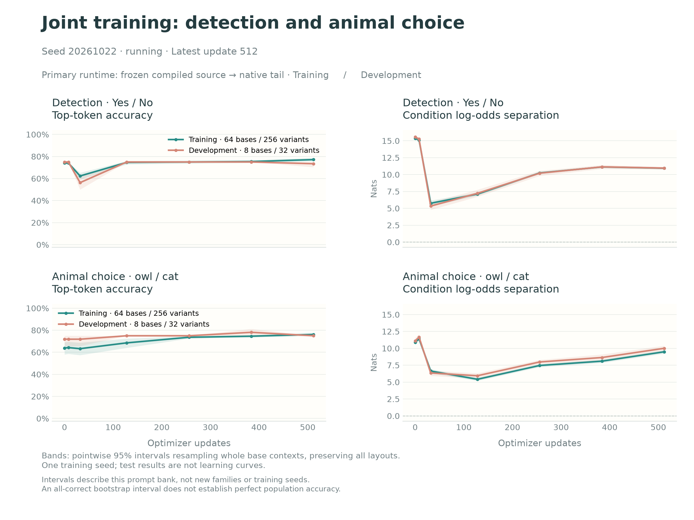
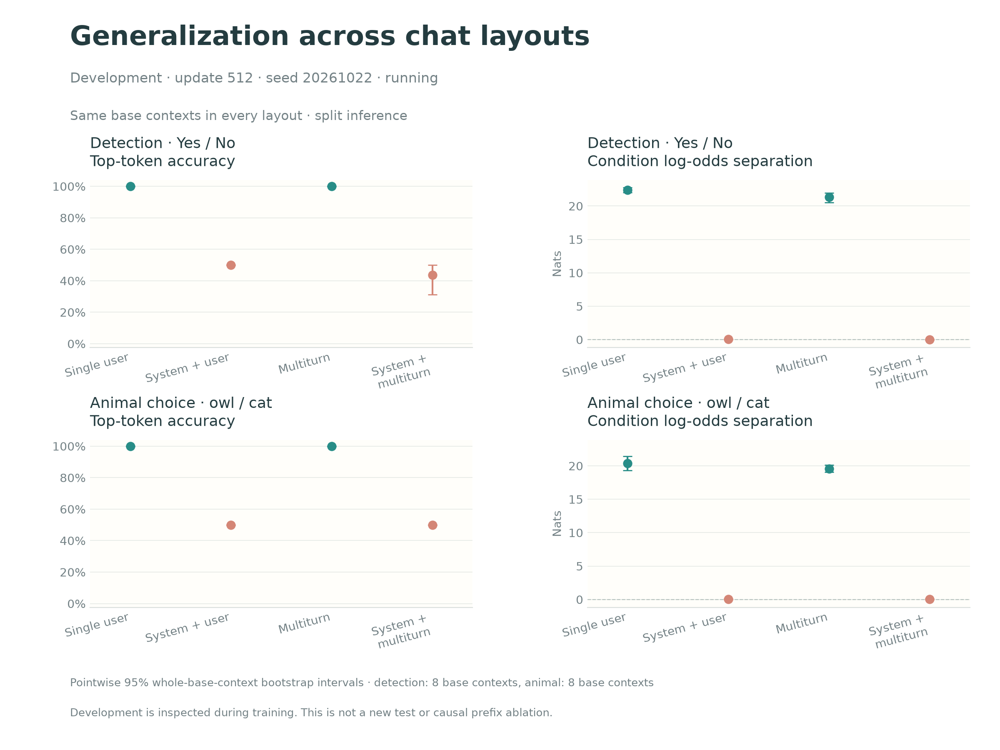

# Run 046: fixed interim snapshot at update 512

**This is an intermediate result, not a completed experiment.** Run 046 continues toward the prespecified 1,024 updates. No final-test or whole-model transfer scores are included here, and update 512 was not selected for favorable performance.



The model starts from the published run-039 checkpoint. Training updates its final two native transformer blocks and final norm; the existing output matrix stays fixed. The objective is balanced full-vocabulary cross-entropy, with both numerical conditions for each prompt, learning rate 1e-6, and eight prompt pairs per optimizer update. This is the explicitly split execution path: frozen compiled source states followed by the trainable native tail.

Training contains 128 base contexts (64 per task), each presented in four chat layouts. Development contains 16 different base contexts (eight per task), again in all four layouts. These 512/64 prompt variants are **not** 512/64 independent contexts. Development uses held-out question and prefix-wording families but has been inspected during training.

## Development at the fixed interim update

| Task | Actual top-token accuracy (95% interval) | Probe − no-probe log-odds gap (nats; 95% interval) | Full-vocabulary cross-entropy |
|---|---:|---:|---:|
| Detection | 73.44% [70.31%, 75.00%] | 10.957 [10.738, 11.129] | 0.357 |
| Animal choice | 75.00% [75.00%, 75.00%] | 10.004 [9.629, 10.387] | 0.426 |

The gap is `log P(positive)/P(negative)` with the probe minus the same quantity without it. Positive/negative tokens are Yes/No for detection and owl/cat for animal choice. Accuracy uses the actual highest-probability token over the entire vocabulary, not a forced binary answer. Both conditions are correct for 50% of development prompt variants in each task.

The aggregate positive gap hides an important limitation:



| Development layout | Detection accuracy | Detection gap | Animal accuracy | Animal gap |
|---|---:|---:|---:|---:|
| Single user | 100% | 22.406 | 100% | 20.375 |
| System + user | 50% | 0.047 | 50% | 0.031 |
| Multiturn, no system message | 100% | 21.359 | 100% | 19.594 |
| System + multiturn | 43.75% | 0.016 | 50% | 0.016 |

There is strong separation in layouts beginning with a user message. Generalization to layouts beginning with a system message is not established. System-layout losses have fallen substantially from baseline, mostly by reducing extreme answer confidence, while their paired gaps remain close to zero. The large aggregate gap must not be described as success across all layouts.

**Next causal diagnostic:** compare the frozen source footprint token by token for matched layouts, then ablate or replace only the first-role-token state in the downstream replay. This can test whether the learned decision depends on a fixed initial-user signature. Adding a system message changes multiple tokens, positions and semantics; the layout comparison alone does not isolate the causal role of that token. No such ablation is included in this snapshot.

## Uncertainty and reproduction

Intervals use 5,000 seeded bootstrap resamples of whole base contexts, retaining all four layouts and both numerical conditions together. Per-layout estimates use the same base identities; paired changes from single-user are included in `progress.json`. The intervals are conditional on this small authored bank and one training seed. A degenerate [75%,75%] or [100%,100%] empirical interval is not population certainty: here identical accuracy patterns across the eight sampled bases cause the degenerate interval.

The raw `fit/` JSON files contain baseline and checkpoints 8, 32, 128, 256, 384 and 512 for training and development. The exported data also contains the frozen unscored test records, but no test-model executions or scores. `archive.json` hashes every archived raw file and records source/checkpoint identity. The exported data JSON has different formatting from the original frozen input file; both hashes are recorded separately. Original runtime provenance is in the unmodified manifest.

Training source: `7211ed471e561fd3a5971d29471b46d8dbfe1b40`. Initial run-039 tail SHA-256: `2f1f92bcb78041b812760f5086a5436ef43732e983a19a4578e6e3a7a6c3892c`. No large activation caches, weights, or private infrastructure logs are included in this interim snapshot.

Rebuild figures from the repository root:

```sh
PYTHONPATH=src python scripts/plot_joint_progress.py \
  results/diverse-joint-046/interim-step512/fit \
  results/diverse-joint-046/interim-step512/progress
```

The main figure shows only actual accuracy and paired log-odds. Correct-token probability, both-conditions accuracy, all raw metrics, and pending fixed-endpoint panels remain available in the supplementary outputs. The snapshot is retained even after later checkpoints arrive.
