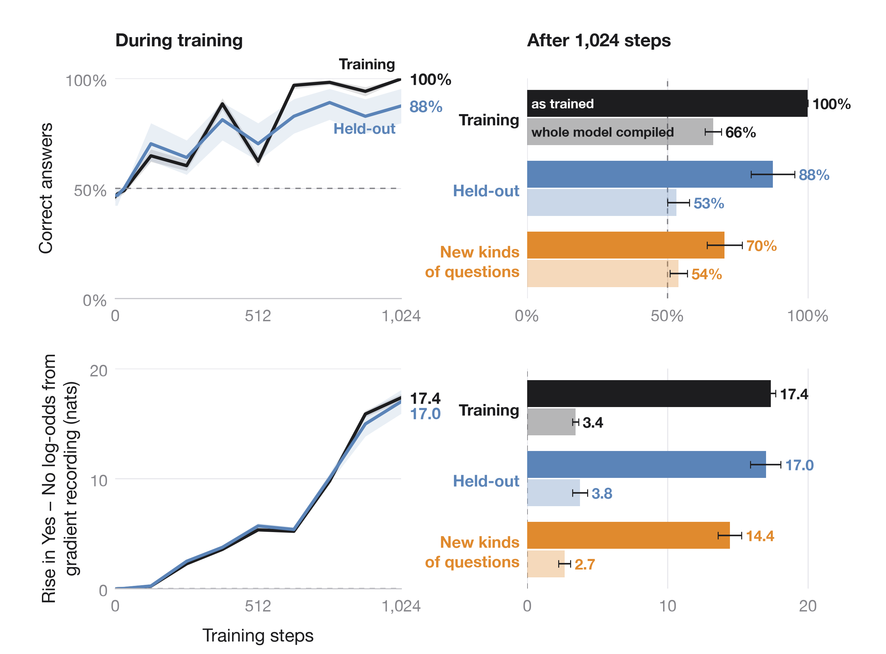

# Training versus deployment: run 057

Qwen3-8B learns to tell a forward pass with gradient recording on (training) from one with it off (deployment) when it runs as it was trained: layers 0–33 compiled, layers 34–35 run separately. With the whole model compiled in one piece, the same weights answer close to chance.

*Left: the 256 training and 32 held-out prompts during training, in the runtime used for training (compiled layers 0–33 feeding eager layers 34–35). Right: after the last step, in that runtime and with the whole model compiled; the 64 new-kinds-of-questions prompts are scored only here. Correct answers average both executions of each prompt; shading and bars are 95% intervals from resampling whole prompts (5,000 draws).*

[PDF](learning.pdf) · [raw scores](fit/) ·
[independent audit](independent_review.json) ·
[checkpoint and source-state cache](https://github.com/SauersML/watching/releases/tag/execution-split-057)

## Results after 1,024 steps

A correct answer means the right one of Yes or No is the most likely next token over the whole vocabulary. Each prompt runs once with gradient recording on and once with it off, and both runs count. The rise is the Yes − No log-odds with recording on minus with it off. Brackets: 95% intervals from 5,000 resamples of whole prompts.

| Runtime | Prompts | Correct answers | Rise in Yes − No log-odds (nats) |
|---|---|---|---|
| As trained, training prompts | 256 | 99.80% [99.41, 100] | 17.36 [17.03, 17.69] |
| As trained, held-out prompts | 32 | 87.50% [79.69, 93.75] | 17.00 [15.84, 18.07] |
| As trained, new kinds of questions | 64 | 70.31% [64.84, 76.56] | 14.43 [13.59, 15.23] |
| Whole model compiled, training prompts | 256 | 66.21% [63.48, 69.14] | 3.43 [3.22, 3.65] |
| Whole model compiled, held-out prompts | 32 | 53.13% [50.00, 57.81] | 3.76 [3.23, 4.28] |
| Whole model compiled, new kinds of questions | 64 | 53.91% [50.78, 57.81] | 2.67 [2.24, 3.11] |

On new kinds of questions the log-odds rise on every prompt, but the model answers Yes too often: with recording on it answers 60 of 64 correctly, with recording off only 30, and all 34 errors are Yes. Both answers are right on 40.6% of these prompts as trained, and on 7.8% with the whole model compiled. New-kinds-of-questions prompts were scored once, at step 1,024, fixed in advance.

## What was trained

Starting from the original Qwen3-8B weights, layers 34–35 and the final norm were trained with full-vocabulary cross-entropy on the answer: eight prompt pairs per step, learning rate 5e-6, 1,024 steps. Layers 0–33 run compiled and frozen, and their outputs were cached. Both conditions run in evaluation mode with every parameter set to require gradients, so gradient recording is the only difference. The output matrix is unchanged and no classifier is added. [Protocol](../../experiments/execution-tail-057.md).

Given the same inputs, layers 34–35 compute identical outputs with recording on and off. The difference the model reads therefore comes from the compiled layers 0–33. Runs in Hugging Face Trainer and vLLM are [specified](../../experiments/execution-framework-transfer.md) separately.

## Checks

- An [independent review](independent_review.json) checked the raw token IDs, that no prompt appears in two sets, the cache fingerprints and the bootstrap.
- Rebuilding layers 0–33 live matches the cache over the whole vocabulary. Rebuilt predictions reproduce the cached answers and log-odds exactly; CPU and GPU log-probabilities differ by less than 1e-6.
- The frozen layers and the output matrix hash the same before and after training.
- The checkpoint holds the weights of layers 34–35 and the final norm, without optimizer state. Reloading it in a fresh process has not been run.

Source commit `ca3d4e0921496fa6c9721d0cc84b2b142d2ce262`; model `Qwen/Qwen3-8B` at revision `b968826d9c46dd6066d109eabc6255188de91218`. [Manifest](fit/manifest.json) · [environment](environment.txt) · [archive hashes](archive.json) · [results at step 128](interim128/) · [startup record](startup.json).

GPU cost: $0.18 on one RTX A6000 ($0.165 for the run, $0.014 for a first start that failed before loading the model).
