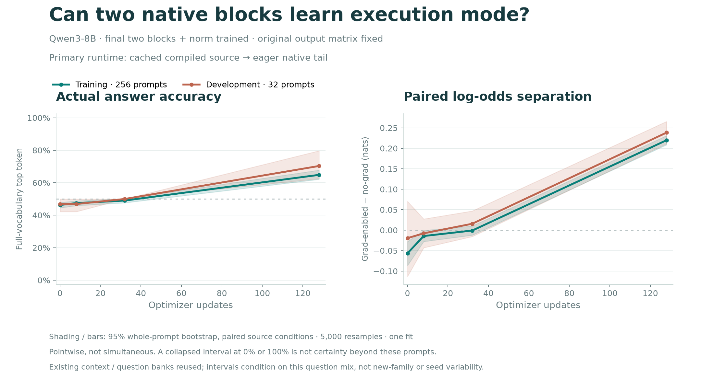

# Execution-mode two-block SFT: run 057

The corrected run **057r is training on an RTX A6000**. At update 128, development
full-vocabulary answer accuracy is **70.31%** and paired Yes/No separation is
**0.2383 nats [0.2109, 0.2656]**. These are intermediate results on 32 development
prompts, not endpoint test or framework-transfer results.

The bands resample whole prompt pairs (5,000 draws), conditional on this question
mix and one training run. They are pointwise, not simultaneous learning-curve
bands. Raw rows and source/file hashes are in [interim128](interim128/).
It follows the [explicit split protocol](../../experiments/execution-tail-057.md):
base Qwen3-8B, frozen prefix, last two native blocks and norm trained, original
output weights fixed. Gradient recording is the source condition; both sources
use evaluation mode. Whole-model transfer is a separate endpoint.

The first launch failed while recording installed packages, before model loading
or training. CUDA preflight passed on an RTX A6000. The bootstrap dependency on
`pip`/`uv` was removed; no scientific check was relaxed. Startup cost was $0.014
including rejected hosts, and all pods were confirmed deleted. Details in
[startup.json](startup.json).
