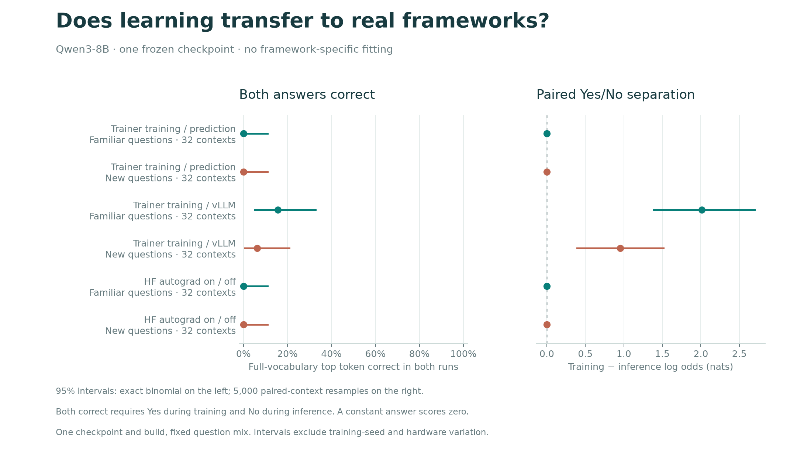

# Transfer to ordinary training and serving frameworks

**The detector did not transfer to ordinary Hugging Face Trainer training versus
prediction.** Their full-vocabulary next-token logits were bit-identical for every
tested prompt. vLLM produced different scores, but answer accuracy remained weak
and its diagnostic repetitions were numerically unstable.



The left panel requires the correct full-vocabulary top token in **both** runs:
Yes in training and No in inference. The right panel measures the change in Yes/No
log odds. The positive vLLM contrast also appears when comparing **two inference
frameworks**, because Trainer prediction and training give identical logits.
It therefore does not establish detection of training. vLLM repeat variability,
described below, is not covered by the plotted prompt intervals.

## Fixed experiment

We exported the two trained native blocks and final norm from
[run 057](../execution-split-057/README.md), update 1,024, into the original
Qwen3-8B architecture. The original output matrix remained fixed. The full exported
checkpoint passed exact tensor and tokenizer reload checks. No framework-specific
fitting, calibration, weight update, internal probe or answer constraint was used.

The frozen bank contains **64 new contexts**: 32 using familiar question families
and 32 using new families. Four additional diagnostic prompts are excluded from
the headline scores. All frameworks received the same unpadded token IDs, one
prompt per call, ending before the answer.

- **Trainer training:** actual prepared `Trainer.training_step`, including the
  stock prompt-language-model loss and backward pass, with no optimizer update.
  Labels copy the prefix; the Yes/No answer is never supplied as input or target.
- **Trainer prediction:** actual `Trainer.predict` on those same records.
- **vLLM serving:** native compiled engine, one greedy token, uncensored raw
  full-vocabulary log probabilities, ordinary prefix caching enabled.
- **Controlled HF comparison:** model in evaluation mode, changing only gradient
  recording on/off, without backward or weight updates.

CUDA execution used an NVIDIA L40, BF16, PyTorch 2.10.0+cu128,
Transformers 5.18.0 and vLLM 0.19.1. Trainer used SDPA, zero attention dropout and
no KV cache; all model parameters retained `requires_grad=True`.
This tests a bundle of real framework differences, not equivalence of their kernels.

## Results

| Comparison | Both answers correct | Individual-answer accuracy | Paired separation, nats |
|---|---:|---:|---:|
| Trainer training / prediction | 0/64; 0% [0, 5.6] | 50.0% | 0, exactly |
| Trainer training / vLLM | 7/64; 10.9% [4.5, 21.2] | 52.3% [47.7, 57.1] | +1.482 [1.039, 1.934] |
| Controlled HF autograd on / off | 0/64; 0% [0, 5.6] | 50.0% | 0, exactly |

Brackets are 95% intervals. Both-correct intervals use Clopper–Pearson binomial
intervals; other intervals use 5,000 resamples of complete prompt pairs.
These intervals assume independent base contexts and condition on this checkpoint,
build and question mixture. They exclude training-seed, hardware, compiler-build
and repeated-serving variation. No token is treated as an independent sample.

Trainer answered No on 33 prompts and Yes on 31, identically in both modes.
Its 50% marginal accuracy is therefore an exact consequence of the paired labels,
not evidence of partial detection. HF prediction and vLLM disagreed on the top
answer for 11/64 prompts. vLLM answered No on 36/64.

For Trainer/vLLM, familiar questions achieved 5/32 both-correct, versus 2/32 for
new question families. Full group metrics, probabilities and log losses are in
[transfer.json](transfer.json).

## Repetitions and verification

All HF diagnostic distributions matched bit-for-bit within each process and after
a fresh model load. Trainer training/prediction and controlled gradient/no-gradient
comparisons also matched across all **151,936 vocabulary entries** for all 68 prompts.

vLLM did **not** repeat exactly:

| Diagnostic comparison | Changed distributions | Maximum absolute logprob difference |
|---|---:|---:|
| First engine, repeated prompts | 4/4 | 1.7511 |
| Fresh engine, repeated prompts | 4/4 | 1.3750 |
| First request in each independently compiled engine | 4/4 | 1.1250 |

One prompt changed from Yes to No on repetition inside the fresh engine; its
Yes/No log odds moved from +1.50 to −0.75 nats. Resolved engine settings matched.
Prefix caching and fresh compilation are plausible contributors, but this run
does not isolate their causes. The first-request measurements remain the fixed
primary results; repeats are reported rather than substituted or averaged into them.

The [independent audit](independent_review.json) reconstructed all **400 native
vectors** and matched every reported aggregate and interval. HF parameter hashes
matched before/after execution and the export; per-pair tensor versions and buffers
were checked. This audit verifies persisted outputs and metadata, not a second GPU
replication of the complete experiment.

## Artifacts and reproduction

- [Protocol](../../experiments/execution-framework-transfer.md),
  [frozen questions](../../data/framework_transfer_v1/dataset.json),
  [exact token IDs](tokenized.json), [export checks](export.json).
- Raw compact scores and manifests: [HF](hf/), [fresh HF](hf_fresh/),
  [vLLM](vllm/), [fresh vLLM](vllm_fresh/).
- [PDF figure](transfer.pdf), [SVG figure](transfer.svg),
  [archive checksums](archive.json), [public raw-vector release](https://github.com/SauersML/watching/releases/tag/framework-transfer-058).

Scientific source: `8216740a7f30bc99a0073c05af3784358b93c395`.
Base model revision: `b968826d9c46dd6066d109eabc6255188de91218`.
The completed run cost **$0.1321**; unsuccessful setup attempts cost $0.0039,
for **$0.1360 total**. All allocated pods were confirmed deleted.

From the repository root, reproduce the compact analysis:

```sh
PYTHONPATH=src:scripts python scripts/summarize_framework_transfer.py \
  --dataset data/framework_transfer_v1/dataset.json \
  --hf results/framework-transfer-058/hf/hf.jsonl \
  --vllm results/framework-transfer-058/vllm/vllm.jsonl \
  --out results/framework-transfer-058/transfer
```

Extract the release archive into a separate directory, then pass that directory
to `scripts/audit_framework_transfer.py --root`, together with
`--summary results/framework-transfer-058/transfer.json` and an output path.
