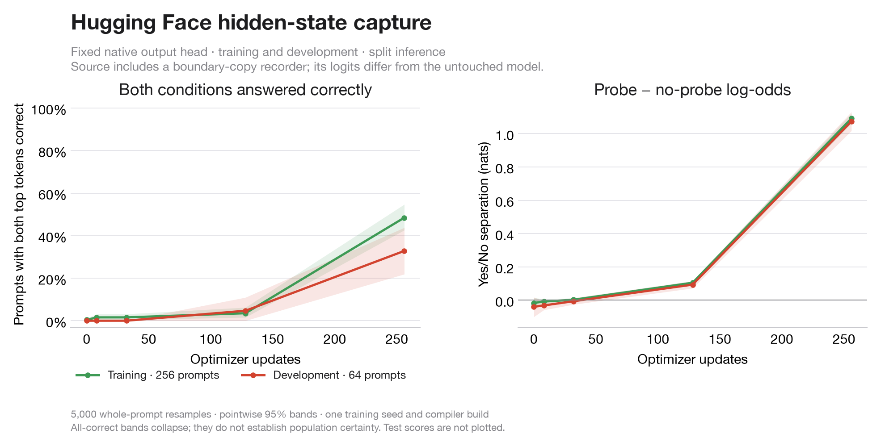

# Native hidden-state capture: training in progress

This intermediate archive is frozen at update 256 of the planned 1,024 updates.
It is not the final result. Qwen3-8B learns with its last two native transformer
blocks and final norm; the original output matrix stays fixed.

The condition is native Hugging Face `output_hidden_states=True` versus `False`.
Both source executions include the same preallocated boundary-copy recorder.
That recorder changes the original compiled model's logits. Consequently these
curves describe the boundary-observed source followed by the native tail, not
untouched whole-model serving. Whole-model transfer will be scored separately.

On 64 development prompts at update 256, the mean paired Yes/No log-odds gap is
+1.074 nats (pointwise 95% prompt-bootstrap interval: +1.018 to +1.131).
Both conditions receive the correct full-vocabulary top token on 21/64 prompts
(32.81%); accuracy over individual executions is 66.41%. Thus separation has
improved, while confident correct classification remains incomplete.

Intervals use 5,000 whole-prompt resamples preserving the two conditions. They
are conditional on this prompt bank, one training seed and one compiler build;
they are not simultaneous learning-curve bands or confirmation on an untouched
test set. These historical contexts have been inspected in earlier experiments.

Raw paired score files and the selected data are in `fit/`; `intermediate.json`
records score-file hashes and the plotted calculations. The update-128 and
update-256 score files were separately fetched and SHA-verified against the GPU.
