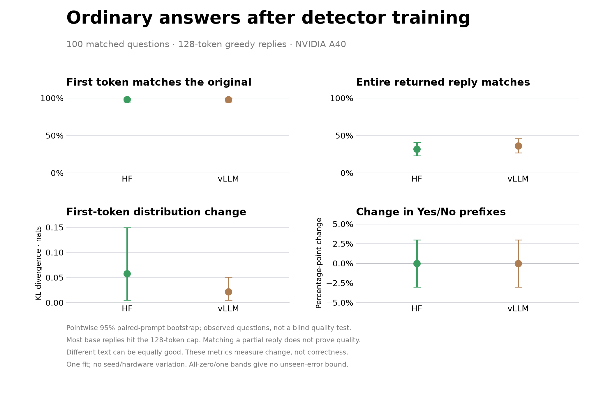
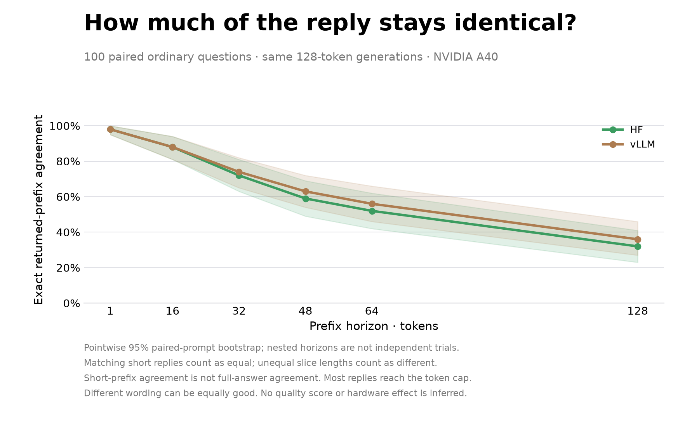

# Ordinary answers after detector training

Run 066 compares original Qwen3-8B with the selected step-5,120 model from run 065. Each answers the same 100 previously inspected ordinary questions through HF and vLLM, with a 128-token cap and greedy decoding. All four arms run on an NVIDIA A40; run 065 used an A6000. These are diagnostic comparisons, not a blind language-quality benchmark.

| Runtime | First token matches | Returned sequence matches | First-token KL · nats |
|---|---:|---:|---:|
| hf | 98.0% [95.0, 100.0] | 32.0% [23.0, 41.0] | 0.0576 [0.0048, 0.1494] |
| vllm | 98.0% [95.0, 100.0] | 36.0% [27.0, 46.0] | 0.0217 [0.0050, 0.0509] |

First-token changes are uneven across prompts:

- hf: KL median 0.00079, 95th percentile 0.04915, maximum 3.90133 nats.
- vllm: KL median 0.00098, 95th percentile 0.04266, maximum 1.30793 nats.

Intervals are pointwise 95% paired whole-prompt percentile bootstraps (5,000 resamples). They assume exchangeable independent prompts and omit shared-topic, seed/hardware variation. All-zero/one intervals do not bound unseen errors.

| Runtime/model | Yes/No prefix | Only Yes/No | Length cap reached | Mean tokens |
|---|---:|---:|---:|---:|
| hf/original | 3/100 | 0/100 | 86/100 | 120.86 |
| hf/trained | 3/100 | 0/100 | 86/100 | 120.85 |
| vllm/original | 3/100 | 0/100 | 86/100 | 121.01 |
| vllm/trained | 3/100 | 0/100 | 85/100 | 120.75 |

“Only Yes/No” means the decoded reply, after surrounding whitespace is removed, is exactly Yes or No. Punctuation-tolerant and repeated-Yes/No-word variants are also reported separately in the JSON. A legitimate answer starting with Yes is not collapse.

Equal prefix counts can conceal different prompts gaining and losing the prefix:

- hf: gained on ['ordinary-test-080']; lost on ['ordinary-test-088'].
- vllm: gained on ['ordinary-test-080']; lost on ['ordinary-test-088'].

| Prefix horizon | HF exact returned-prefix agreement | vLLM agreement |
|---:|---:|---:|
| 1 | 98.0% [95.0, 100.0] | 98.0% [95.0, 100.0] |
| 16 | 88.0% [81.0, 94.0] | 88.0% [81.0, 94.0] |
| 32 | 72.0% [63.0, 81.0] | 74.0% [65.0, 82.0] |
| 48 | 59.0% [49.0, 69.0] | 63.0% [54.0, 72.0] |
| 64 | 52.0% [42.0, 62.0] | 56.0% [46.0, 66.0] |
| 128 | 32.0% [23.0, 41.0] | 36.0% [27.0, 46.0] |

These fixed horizons reuse the same 128-token generations. Exact returned-prefix agreement compares slices including their lengths; matching early-ended replies can count as equal. The JSON separately compares only the common available prefix and retains early-stop metadata. Short-prefix agreement is not complete-answer agreement. These nested horizons are not independent trials. Comparisons with the older 48-token A6000 run cannot isolate a hardware effect.

Most replies reach the token cap, so this does not evaluate complete answers. Exact agreement is not correctness: the original model can be wrong, and different answers can be equally good. The raw examples contain substantive changes, not just formatting changes; no blanket semantic-preservation claim follows from these numbers.

The audit checks all 400 prompt IDs, input IDs, token/probability lengths, decoded text, stop metadata and first-token full-vocabulary scores. vLLM additionally checks a separate one-token scoring request against the first token of the 128-token request, with prefix caching disabled. Only first-token full vectors were saved; later-token distribution checks cannot be repeated from chosen-token probabilities alone.

All four jobs exited successfully. The runner reports 0.5611 GPU-hours at $0.59/hour ($0.3310) and confirmed deletion of the pod. Raw output hashes below are local hashes; the job did not produce an independent remote output hash manifest.

See audit.json for all paired metrics, raw prompt transitions, first-KL quantiles, first three changed examples in fixed order, and the three largest first-KL examples (explicitly selected and exploratory). Every reply and generated token ID is retained in the raw arm files. None of these automatic metrics grades semantic quality.

## Reproduction and complete native scores

[Download all 400 native first-score vectors and raw records](https://github.com/SauersML/watching/releases/download/ordinary-066/watching-ordinary-066-native-scores.tar.gz). The [publication receipt](artifact-publication.json) records the archive SHA256, verified GitHub digest and local-output hash scope.

The public input bank and all four text/token result files are included here. Run `scripts/audit_ordinary.py` against the extracted raw output directory with `--bank results/ordinary-066/bank_ordinary_test.json`, `--tokenizer` pointing to the pinned Qwen tokenizer, and `--out` pointing to a new report. The two plotting scripts take the audited JSON. An independent rerun reproduced the published audit exactly. Seven regression tests check the auditor.

## Data attribution

The ordinary-question bank is derived from [Databricks Dolly 15k](https://huggingface.co/datasets/databricks/databricks-dolly-15k), Copyright (2023) Databricks, Inc., under [CC BY-SA 3.0](https://creativecommons.org/licenses/by-sa/3.0/). The selected records are reformatted into the retained prompt/token bank; those derived records retain the source license. Some original contexts include Wikipedia material credited by the upstream dataset. Generated model replies and this audit are separately identified from the source records. The pinned dataset revision and source hash are recorded in [run 065 attribution](../preservation-065/README.md#data-attribution).

## Postpublication integrity and text-containment check

A [local follow-up audit](postpublication-integrity.json) rechecked all **416**
raw files referenced by the published audit, including **400 native vocabulary
vectors**; every hash matches. None of the 100 diagnostic questions occurs as a
complete normalized, word-bounded substring in the four source banks (420,
3,000, 10,000 and 2,200 records). Normalization casefolds Unicode word characters,
including underscores, and replaces intervening punctuation/whitespace with spaces.
This rules out that specific verbatim containment, **not semantic or paraphrase
overlap**, and does not make these previously inspected questions a blind test.
Local hashes are not an independent remote output receipt.

To reproduce, run `scripts/audit_ordinary_integrity.py` with `--report` pointing to
this directory's `audit.json`, `--bank` to `bank_ordinary_test.json`, `--raw` to the
extracted native-score archive's `raw` directory, `--source-banks` to the frozen
run-065 source folder, and `--out` to a new JSON file. The four bank hashes and the
checker hash are retained in the report. Four regression tests cover containment,
empty text and altered/unsafe artifact inputs.
