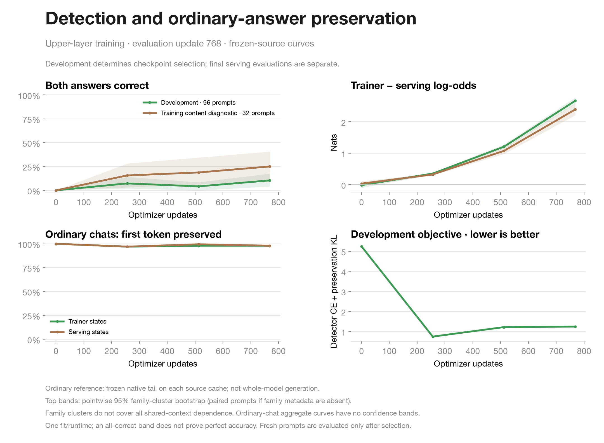
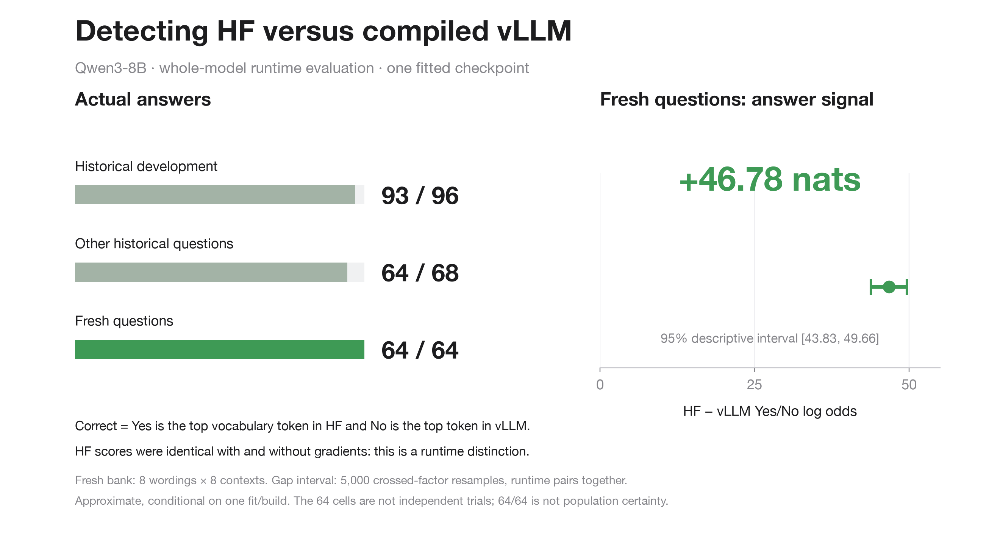

# Runtime detection with language preservation (065)

**Status: all 6,144 training updates are complete; update 5,120 was selected. The fresh whole-model runtime test and the separate four-arm ordinary-answer evaluation are complete and audited.** This is a new experiment from the original Qwen3-8B checkpoint. It is not a continuation of run 064's interrupted fourth fit: that fit did not save weights.

The preceding detector learned to distinguish captured Hugging Face training states from vLLM serving states, but its 100 ordinary-question replies all **started** with Yes or No (versus 3/100 for the base model). This is first-token bias, not evidence that every reply consisted only of those words: 0/100 were literal Yes/No-only answers, and 2/100 contained only repeated Yes/No words. Many continued with prose. The [raw-text metric audit](run064-ordinary-metric-audit.json) separates these cases; the earlier generation file lacks token IDs and stopping reasons. This run retains the detector objective and adds a preservation loss focused on the reply: half the KL divergence at the first answer position, half the mean across reply positions. Prompt-token agreement cannot dominate this preservation score.

Only native upper-model modules are trained: block 34 after attention, block 35, and the final normalization. The original output matrix remains fixed. Training uses frozen source activations, eight paired detection prompts per optimizer update, and two ordinary chats from each runtime per update. The target is 6,144 updates, bounded by a 4,200-second training-loop cap within a three-hour pod cap. A bounded partial run is saved and evaluated with its actual completed update count; it is not reported as complete.

Checkpoint selection minimizes the fixed held-out objective used for training: full-vocabulary detection cross-entropy plus mean reply-focused preservation KL across both runtimes. The initial base model is a candidate. Neither fresh-test scores nor generated answers select the checkpoint.

The selected update 5,120 answers both conditions correctly on **96/96 cached-source
development prompts**, with strictly positive Yes/No margins and no exact ties.
The mean paired log-odds separation is **54.056 nats [51.772, 56.584]**;
full-vocabulary correct-token log loss is **0.000933**, and mean correct-token
probability is **99.91%**. All-correct bootstrap bands collapse and do not establish
perfect population accuracy. The final update 6,144 scores 95/96; selection uses
the fixed development objective rather than the final update by default.

The actual whole-model historical evaluation answers both conditions correctly
on **93/96 development prompts** and **64/68 other historical prompts**.
Repeated vLLM passes agree on classifications but differ in many numerical scores.
These evaluations enable prefix caching, unlike source collection; that difference
is a hypothesis for the numerical variation, not an established cause.
The locked fresh wording/context grid scores **64/64 pairs correct in both runtimes**, in both serving repetitions. See the [whole-model endpoint report](endpoint-status.md) and [raw-score audit](fresh-endpoint-audit.json). This tests eight new wordings crossed with eight new contexts, not new semantic families.

**The detected condition is HF versus compiled vLLM execution, not gradient recording within HF.** Actual HF Trainer and HF eval/no-grad final-position vocabulary vectors match exactly on all 64 fresh and 164 historical prompts. The plain HF comparison has a final-norm capture hook; its equality receipt is preserved, while only the Trainer vector is archived.

See [scores and caveats](progress-status.md), the
[raw learning-curve receipt](progress-raw/SOURCE.json), the
[final checkpoint verification](final-checkpoint-verification.json), and the
[historical runtime audit](historical-endpoint-audit.json). Remote and local hashes
match for the saved optimizer and compact tail; all 17 selected tail tensors
match the best weights stored in the completed checkpoint.

[Figure data, source, and interval scope](endpoint-figure/README.md). The two historical banks and the fresh grid are shown separately.

## What the evaluations mean

- **Learning curves:** frozen native source activations passed through the learned eager tail. The training diagnostic is the first 32 content prompts by sorted identifier, not a representative estimate over the 13,251 eligible training prompts (13,256 were planned). Both-condition accuracy requires the correct top token across the entire vocabulary in both executions of the same prompt. Log-odds separation measures Trainer Yes-minus-No minus serving Yes-minus-No.
- **Final runtime checks:** a fresh real `Trainer.training_step` and an ordinary unhooked vLLM engine execute the exported model. These are separate from the source-state learning curves; transfer is not assumed.
- **Ordinary questions:** first-answer agreement and reply KL during training use the frozen original eager Hugging Face tail on each source cache. On vLLM states this is a hybrid reference, not saved whole-vLLM generation scores. These are followed by 100 Hugging Face free generations from the original and fitted models. This generation stage does not test vLLM answer quality. This diagnostic bank has been inspected previously and is not a blind language benchmark.
- **Fresh questions:** 64 prompts cross eight new wordings with eight new contexts. Exact token overlap with the previous prompt banks is zero. This tests fresh wording/context generalization, not entirely new semantic families.

The historical development/test banks have already informed previous experiments and are exploratory. Progress bands use 5,000 whole-family bootstrap resamples when metadata permit, retaining each prompt's two conditions together. They are pointwise intervals conditional on one training run and runtime. Family clustering does not account for all crossed dependence from shared contexts. These intervals do not include training-seed or hardware variation, and an all-correct bootstrap interval does not prove perfect population accuracy. Ordinary-chat progress has aggregate scores only, so no confidence interval is inferred from it.

## Provenance and artifacts

The exact immutable source manifest is [SOURCE_SHA256.json](SOURCE_SHA256.json), with the planned parameters in [RUN_SPEC.json](RUN_SPEC.json) and [PLAN.md](PLAN.md). Their original prelaunch status labels are retained verbatim. The complete frozen launch package is [source-r1.tar.gz](source-r1.tar.gz); its identity is recorded in [source-archive.json](source-archive.json), alongside the actual run-upload archive identity. The public archive omits bytecode; the archive bytes differ, but all 86 manifest-listed source files have identical verified hashes.

Base: `Qwen/Qwen3-8B` at `b968826d9c46dd6066d109eabc6255188de91218`. Runtime: PyTorch 2.10.0, Transformers 5.18.0, vLLM 0.19.1. Pod: RTX A6000, $0.59/hour, three-hour allocation cap. Full-vocabulary capture parity passes on four prompts per source. This is distinct from the initial cached-tail replay check, which compares only Yes/No log-odds on eight development prompts; it does not establish full-vocabulary replay equality. Hugging Face cache collection uses no-gradient execution, with a separate four-prompt check against actual Trainer outputs. The contrast is between the specified Hugging Face and vLLM computations, not isolated gradient recording. Raw source states, scores, checkpoints, and logs are retained; completed results will be added only after verification.

## Data attribution

The ordinary-chat training/development records and the ordinary-answer diagnostic
are drawn from [Databricks Dolly 15k](https://huggingface.co/datasets/databricks/databricks-dolly-15k),
Copyright (2023) Databricks, Inc., under [CC BY-SA 3.0](https://creativecommons.org/licenses/by-sa/3.0/).
The selected records are reformatted into tokenized prompt/reply banks for this
experiment; these derived dataset records retain that license. Some source
contexts include Wikipedia material credited in the upstream dataset card.

The exact source JSONL at revision `bdd27f4d94b9c1f951818a7da7fd7aeea5dbff1a` has
SHA256 `2df9083338b4abd6bceb5635764dab5d833b393b55759dffb0959b6fcbf794ec`.
The active pod's downloaded copy was independently matched to the inspected local
copy before the offline ordinary-answer stage. This cache warmup changed no
experiment source or prompt bank.

The [Hugging Face cache structural audit](hf-cache-structural-audit.json) checks 13,420 unique records and 598,067 token states. It verifies shape and coverage, not remote/local hash equality or numerical equivalence.

## Prepared ordinary-answer follow-up

The [separate evaluator](ordinary-followup/README.md) completed as [experiment 066](../ordinary-066/README.md).
It compares base and selected models under Hugging Face and vLLM, preserves native
score records, generated token IDs and stopping metadata, and distinguishes
Yes/No prefixes from replies containing only those words. The 100 prompts are the
same previously inspected diagnostic bank. Six CPU tests cover scoring and
provenance gates; all four GPU arms and 400 raw-score checks passed. No current-run source
was changed.

## Capture exclusions and future resume repair

All 13,420 detector records were captured, but the prespecified boundary-matching
filter accepts 13,415. Five training records fail its relative-L2 error threshold:
`wide-0828`, `content-03233`, `content-06750`, `content-08100`, and `content-08467`.
They are excluded from both sides of paired training, leaving 13,251 eligible
training prompts. All 96 development records and all 2,200 ordinary-chat records
pass. All records identify distinct attention/residual candidates consistently;
the failures reflect larger numerical differences, not ambiguous tensor identity.
Consequently this is training on the numerically matched subset, not the complete
unfiltered bank. The wrapper's four-prompt full-vocabulary parity test is separate.

The independent review also found that resuming a completed partial pipeline could
reuse stale exports/evaluations after its selected weights changed. A
[dependency-pinned repair](resume-fix/REVIEW.md), with eight regression tests, is
prepared for future packages. It preserves old outputs and ties downstream reuse
to selected-weight and input hashes. It has **not** changed the frozen source or
the current first execution. Any continuation must use a newly verified package
and must not treat a previously inspected fresh bank as untouched confirmation.

## Ordinary replies after preservation training

The [completed 48-token Hugging Face diagnostic](ordinary-48-token/README.md)
finds 59/100 identical base/trained replies. Both models begin 3/100 replies with
Yes or No; neither produces a literal Yes/No-only decoded reply. These are
previously inspected questions, disjoint from the preservation train/development
bank. The 98.989% logged agreement is over teacher-forced answer positions, not
prompt tokens or first-token-only agreement. This evaluator did not retain EOS
metadata, so it does not establish natural completion or general answer quality.

A separate 128-token check of base and trained models under both Hugging Face and
vLLM completed as [watching-ordinary-066](../ordinary-066/README.md) on an A40. It retains token IDs, stopping metadata, and native scores. Its vLLM arms disable prefix caching and verify the first-score request against generation. Both runtimes retain the original first token on 98/100 prompts, while full returned sequences match on 32/100 HF and 36/100 vLLM prompts. Most replies hit the cap. These measure change, not correctness or general language quality.

## Full native endpoint scores

[Download the raw historical and fresh vocabulary tensors](https://github.com/SauersML/watching/releases/download/preservation-065/watching-preservation-065-endpoint-scores.tar.gz). The [asset receipt](endpoint-archive.json) records its SHA256 and verified GitHub asset identity; [inventory](endpoint-artifact-inventory.json) records individual file hashes. Scalar records and the fresh bank are included in [endpoint-raw](endpoint-raw).

## Released native model

The full checkpoint is [Sauers/watching-train-deploy-preservation-065](https://huggingface.co/Sauers/watching-train-deploy-preservation-065/tree/68dd8c269ee793077ee98d085e2a51a6b334a152). It preserves the original architecture and output matrix; only the 17 trained tensors differ. All five published weight-shard hashes match the verified local export. The [readback receipt](huggingface/hub-verification.json) records the immutable revision and checks of the model card, license, provenance and configuration. This verification uses Hub LFS hashes, not a second full download of the weights.

The model card now includes the completed ordinary-answer audit at [metadata revision cbf31cfe](https://huggingface.co/Sauers/watching-train-deploy-preservation-065/tree/cbf31cfe354c7f133752b8d8c30407f9ab78be34). All five weight-shard hashes are unchanged; [updated readback receipt](huggingface/hub-verification-066.json).
