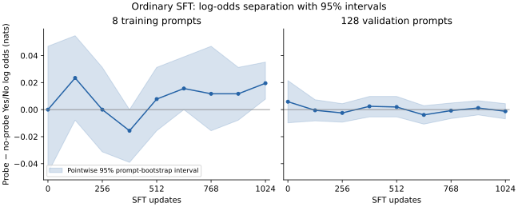

# Eight-prompt SFT experiment

**This run did not establish learning to detect the probe.** We trained all parameters of Qwen3-0.6B for 1,024 ordinary SFT updates on eight paired prompts. Every prompt appeared with and without the reference-capture probe at layer 14's query norm. Inputs were identical across conditions; target answers were Yes and No, respectively.

The experiment used bf16 CUDA Inductor on an RTX 3090, FP32 master AdamW weights and gradient accumulation, batch size four paired prompts, and peak learning rate 1e-5 with warmup and cosine decay. Both conditions' gradients were accumulated before each update. All settings and source hashes are in `manifest.json`. Source commit: [`d2a19b2`](https://github.com/SauersML/watching/tree/d2a19b2b9b184e1dac91b08738084bc7409d9aba).

## Log-probability results

For each prompt define `s = log P(Yes) − log P(No)` and separation `d = s_probe − s_absent`. Learning is measured as the change in separation from before training to the fixed final checkpoint. Bootstrap draws keep all four scores for each prompt together.

| Split | Prompts | Initial separation | Final separation | Change [95% interval] |
|---|---:|---:|---:|---:|
| Training | 8 | 0.00000 | +0.01953 | +0.01953 [−0.03125, +0.07031] |
| Validation | 128 | +0.00586 | −0.00122 | −0.00708 [−0.02393, +0.00952] |
| Test | 128 | −0.00879 | −0.00024 | +0.00854 [−0.01660, +0.03345] |

Values are nats, measured in no-gradient compiled inference. Every change interval includes zero. The eight training prompts' final separation alone is positive, but the baseline-to-final change is inconclusive; that endpoint alone is not evidence of learning. The gradient-enabled training path also had an inconclusive improvement: +0.01953 nats [−0.03906, +0.07813].

The shaded bands are pointwise 95% prompt-bootstrap intervals (5,000 resamples, seed 42). A [training-prompt detail figure](training_confidence.pdf) shows both separation and its matched change from baseline. These answer different questions: final separation on the eight seen prompts has interval [+0.00781, +0.03516], while its improvement over baseline has interval [−0.03125, +0.07031]. The latter is the learning comparison used above.

An exact non-parametric sign check further limits the endpoint interpretation: the eight final differences comprise four positives, zero negatives, and four ties (one-sided p=0.0625; two-sided p=0.125). The eight before/after changes comprise four positives, one negative, and three ties (one-sided p=0.1875; two-sided p=0.375). Ties are excluded from these binomial tests. The final percentile-bootstrap interval excluding zero is therefore not, by itself, robust evidence at the 5% level with this small discrete sample.

Training did change the model's answer bias. On test prompts, mean Yes-versus-No log odds without capture fell from +3.4014 to −0.2961. That shared shift is distinct from learning to distinguish the two conditions.

## Fresh-process check

The final checkpoint was evaluated again in a fresh Python process and compiler cache. Test separation was −0.00171 nats, again near zero. The scores were **not bit-identical**: Yes-minus-No log odds differed on 174/256 condition/prompt combinations, by at most 0.125 nats. This run does not isolate the source of that discrepancy. The near-zero separation conclusion holds in both evaluations.

## Scope and artifacts

This is one seed, one model, one site, and one learning-rate schedule. It does not establish that the footprint is unlearnable. Eight-prompt bootstrap intervals are especially limited; all intervals quantify prompt variability within this run, not training-seed uncertainty. No negative-control training run was performed.

- `*_inference.json` and `*_grad.json` contain individual scores, including full-vocabulary log probabilities for both labels. `fresh_test_1024_inference.json` records the independent evaluation.
- `analysis.json` contains matched before/after comparisons with 5,000 bootstrap draws, seed 42.
- `data.json` contains the actual prompts; `learning_curve.csv` contains every evaluation checkpoint.
- `plot.py` reproduces the figure with matplotlib. Recompute an endpoint comparison with `python -m watching.compare results/sft-002/test_0_inference.json results/sft-002/test_1024_inference.json --seed 42`.

The training and evaluation command took about 11 minutes, including dependency installation and compilation. Optimization plus its periodic evaluations took about 190 seconds; peak allocated GPU memory was 12.61 GB. Total GPU cost was $0.0932. The worker was deleted after copying results, and its temporary budget exception was removed. Low-utilization shutdown was disabled for this run at the user's request; its 45-minute cap remained active.
