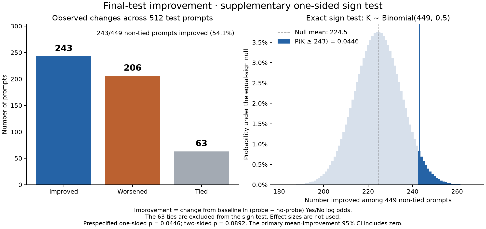
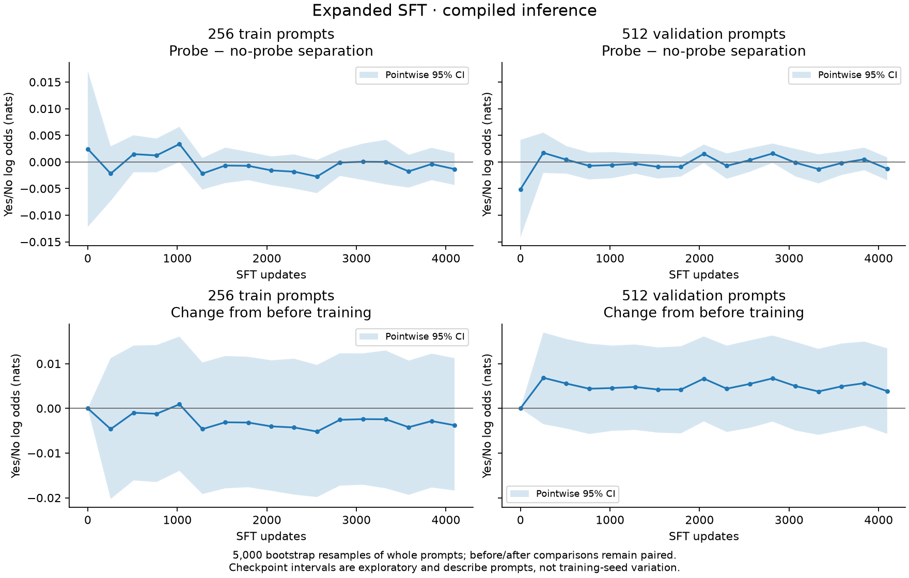

# Expanded ordinary SFT

This run did not establish useful probe detection. The final held-out log-odds separation was essentially zero, and the primary confidence interval for improvement included zero. A prespecified supplementary one-sided sign test gave p=0.0446; this weak directional result does not establish a positive mean effect or successful final discrimination.

## Setup

Qwen3-0.6B, bf16, Hugging Face Transformers 5.18.0, PyTorch 2.10.0 with CUDA 12.8 and Inductor, NVIDIA RTX A5000. All 596,049,920 parameters were trainable. The read-only probe retained the layer-14 query-norm output as a compiled graph output. Capture and no-capture executions used identical inputs and weights before each update.

Ordinary full-vocabulary SFT ran for 4,096 updates, eight epochs over 2,048 prompts, batch size four paired prompts, peak learning rate 1e-5, sequence length 64. It started from the original pretrained weights, with FP32 master weights and gradient accumulation. This was not the optional paired-separation objective.

The data combine eight passage templates, 32 nouns, 64 numbers, and four question phrasings. Training, validation, and test contexts do not overlap, but share the generator and question phrasings. The 2,048 unique inputs do not represent 2,048 independently written ideas. Read the [training prompts](training_prompts.txt) and [all splits](data.json).

## Fixed final checkpoint

Let `s = log P(Yes) − log P(No)` and `d = s_capture − s_absent`. Improvement is the matched-prompt difference `d_final − d_initial`. All numbers below are nats from compiled inference.

| Split | Prompts | Final separation | Improvement | 95% CI for improvement |
|---|---:|---:|---:|---:|
| Fixed training subset | 256 | −0.00134 | −0.00378 | [−0.01837, +0.01123] |
| Validation | 512 | −0.00128 | +0.00385 | [−0.00571, +0.01343] |
| Final test (primary) | 512 | −0.00009 | +0.00479 | [−0.00534, +0.01477] |

The final-test separation itself had 95% CI [−0.00214, +0.00186]. Median improvement was zero. The supplementary improvement sign test counted 243 positive differences, 206 negative differences, and 63 ties: one-sided p=0.04461, two-sided p=0.08922. The endpoint sign test gave one-sided p=0.28374. These tests address different quantities; the supplementary result does not supersede the prespecified primary magnitude analysis.



The [sign-test PDF](sign_test.pdf) plots the counts and the exact binomial null. Rebuild it with `PYTHONPATH=src python results/sft-003/plot_sign_test.py`.

All reported intervals use 5,000 non-parametric bootstrap resamples of whole prompts, seed 42. Before/after resampling preserves the four condition/time scores for each prompt. Intervals describe this synthetic prompt distribution for one training seed. Checkpoint intervals are pointwise and exploratory; the final checkpoint was fixed before training, not selected from the curve. See the [plan and runtime revision](PLAN.md).

The complete per-prompt final-test records matched exactly after loading the checkpoint in a fresh process and compiler cache. This consistency check does not establish robustness across hardware or compiler versions.



## Artifacts and provenance

- [Machine-readable final analysis](analysis.json), [checkpoint comparisons](checkpoint_comparisons.json), [curve CSV](learning_curve.csv), and [PDF](learning_curve.pdf).
- [Raw per-prompt log probabilities and metrics](raw/). Runtime output-directory paths are replaced with `RUN_OUTPUT`; scores are unchanged. The retained full checkpoint is about 1.1 GiB and is not committed to Git.
- Training source commit: `1d77e874f43591a75148cef7e97925059e71960e`; runtime source hashes match it. The initial model's worker-cache revision was `c1899de289a04d12100db370d81485cdf75e47ca`. The runtime config did not expose that hash; it was read from the worker cache before shutdown.
- An initial L4 attempt was stopped for runtime at approximately 460 updates, before its first scheduled post-training inference evaluation. It did not supply weights to this run. Its [partial metrics](interrupted_attempt_metrics.jsonl) are preserved.
- Completed-run cost: $0.0916; interrupted attempt: $0.0777; total: $0.1693. The worker command finished in 1,197 seconds, including training and fresh evaluation. Both GPU pods were confirmed deleted, and exact-run budget exceptions were removed.

Rebuild checkpoint statistics and plots with the repository package and matplotlib installed:

```sh
PYTHONPATH=src python results/sft-003/report.py results/sft-003/raw
```

No negative-control training run was performed. The result limits this SFT configuration; it does not prove the computational footprint cannot be learned with another method.
