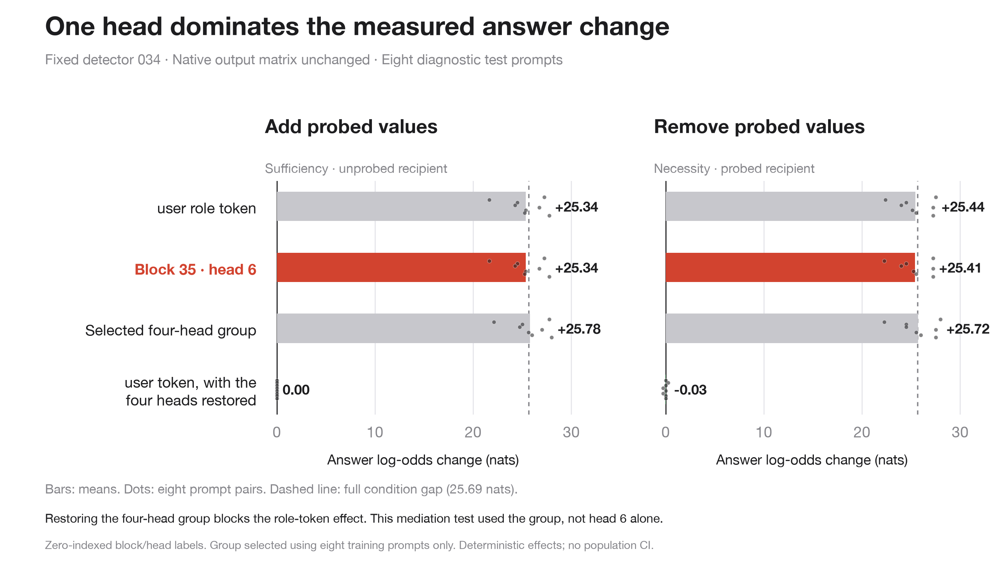

# 044: Role-token signal and native attention-head mediation

The completed audit identifies a sharply concentrated downstream mechanism in the
fixed 034 detector. Block 35, head 6 (zero-indexed: the final block's seventh query
head) accounts for nearly the entire measured answer change when its output at
the answer position is swapped between the two conditions. A four-head group,
chosen on training prompts only, blocks the upstream role-token effect when
restored to its recipient-condition values.

This is a post-hoc circuit diagnostic using exactly 041r's eight practiced and
eight previously evaluated test prompts. It is not another training run or an
independent generalization test. All input tokens, masks, rotary tensors, sequence
shapes, weights, and the native output matrix remain fixed across conditions.

The standalone figure uses the current paper palette and typography, without
changing existing paper figures. Regenerate it with
`python scripts/plot_tail_circuit.py`; PNG/PDF/SVG and a checked raw-data snapshot
are saved here. Points show eight deterministic prompt effects; no CI is implied.

## Measured interventions

Sufficiency patches values from the probed run into the unprobed run; necessity
patches unprobed values into the probed run. Both measure changes in native Yes/No
log-odds. Positive values favor the hypothesized causal effect.

| Intervention | Train sufficiency / necessity | Test sufficiency / necessity |
|---|---:|---:|
| Only the input `user` role-token state | 26.750 / 26.703 | 25.344 / 25.438 |
| Only block 35 head 6, answer position | 26.625 / 26.625 | 25.344 / 25.406 |
| Fixed train-selected four-head group | 27.031 / 27.016 | 25.781 / 25.719 |
| Role-token patch, selected heads restored | −0.063 / −0.063 | 0.000 / −0.031 |
| First `<\|im_start\|>` token, zero difference | 0.000 / 0.000 | 0.000 / 0.000 |

Entries are means in nats over eight paired prompts per split. Full baseline gaps
are 27.031 nats (train) and 25.688 nats (test). Mean within-prompt shares for head
35:6 are 98.49%/98.50% on train and 98.62%/98.91% on test. Raw negative effects and
shares above 100% are retained; nonlinear effects need not be additive or bounded
by the baseline gap. The source code leaves shares undefined for gaps below one
nat; no current baseline is near that threshold.

Every one of the 64 heads was measured individually in both directions. The
training-only ranking was head 35:6 (26.625 nats), 35:8 (0.1875), 35:9 (0.1094),
then 34:14 (0.0391). This exact top-four selection was saved before test execution.
The single-head test scan is explicitly exploratory; it did not change the group.

The mediation intervention first changes only the upstream role-token state, then
restores selected head slices to their recipient-condition baseline. Other heads
and tokens continue computing normally. Removing nearly all of the role-token
effect this way supports mediation through the selected group. It does not prove
that head 6 alone mediates that upstream effect: the group, not that single head,
was clamped in this particular path test.

Component reference swaps add context. On test prompts, swapping the final
attention output at the answer position gives 25.81/25.77 nats, while swapping the
final MLP output gives 6.20/5.94 nats. Block 34's answer-position swaps are near
zero, while its whole-sequence attention and MLP swaps have substantial effects.
These are separate nonlinear interventions, not an additive decomposition.

## Integrity and scope

- All 16 prompt pairs passed exact archived answer-score replay and full-vocabulary
  capture parity. Every captured component passed no-op self-patching.
- Whole-input swaps, baseline restoration and selected-group self-patching passed
  bitwise full-vocabulary checks. The unchanged first-marker state produced no
  effect in either direction.
- Inputs to native `o_proj` are the 32 flattened **query-head** outputs per block,
  not the eight grouped key/value heads. Native `down_proj` inputs and attention/
  MLP outputs were also captured for later refinement.
- All forwards used the existing eager BF16 math-SDPA native tail on the verified
  compiled-source cache. There was no variable batching, new output head, changed
  prompt, truncated prefix, or hook in the compiled source.
- No confidence intervals are manufactured from deterministic repeats or heads.
  The analysis does not establish an entire minimal circuit, unique attention
  routing, particular MLP neurons, or general awareness of monitoring.

Method provenance is the committed SauersML/params circuit-finder patching method
at `4af1a97c7f3c9a3b9cf4a68fea127d1905937fd9`; its changing worktree was untouched.
The full pre-run design is [experiments/tail-circuit-044.md](../../experiments/tail-circuit-044.md).

## Reproduction and artifacts

Run `python3 results/tail-circuit-044/analyze.py` to rebuild `summary.json` and check
measurement coverage and train-before-test selection order. Raw manifests,
selection, baselines, scores and JSONL are unchanged completed-run files. The
activation release contains both conditions' full-sequence native head/neuron/
component tensors for all 16 prompts; per-file sizes and SHA-256 hashes are in
`archive.json`.

Source revision: `49adc78795f9b5325b5de00e0bd1d111dca6bee7`. L40S, driver
550.144.03, Torch 2.10.0+cu128, Transformers 5.18.0. Diagnostic computation took
34.94 seconds; total charged cost was $0.0375. Pod deletion was confirmed and its
exact approval entry removed. No additional model training occurred.
