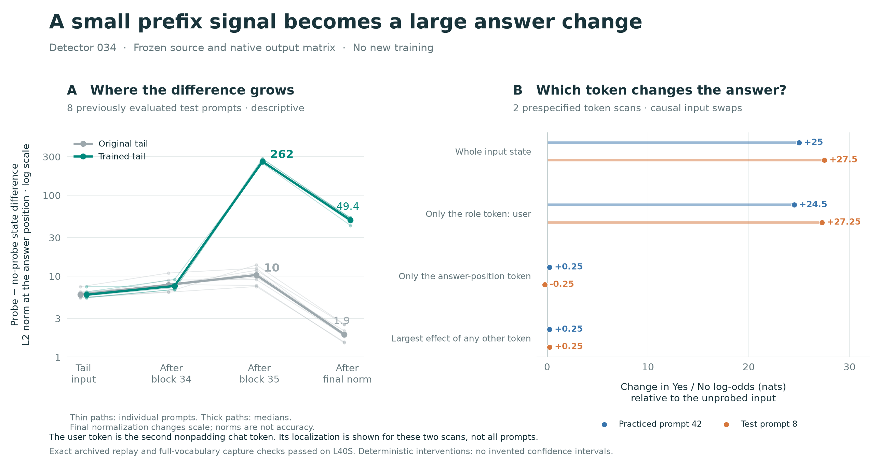

# Frozen-tail causal audit: exact replay on L40S

The saved 034 detector amplifies a small, existing activation difference in its
last transformer block. In the two prespecified token scans, the difference at
the chat-role token `user` accounts for almost the entire answer switch.

This is a post-hoc mechanism diagnostic on eight practiced and eight previously
evaluated test prompts, each run through the original and trained native tail.
It is not another training run or an independent generalization test.

The figure generator is `scripts/plot_tail_mechanism.py`. It validates all replay
and capture gates, paired baselines, token-scan coverage and source-cache identity
before rendering. Run it from the repository root to regenerate PNG/PDF/SVG and
`figure_snapshot.json`. `token_identity.json` records exact token IDs and positions
verified from the released cache. Thin left-panel paths are individual prompts;
the right panel shows the two prespecified scans separately.

## Validation and runtime

- All 32 original/trained prompt cases passed full-vocabulary capture parity.
- All 24 available archived answer-score comparisons were bit-identical. Original
  test-prompt baseline scores were not archived; those eight comparisons are
  explicitly unavailable.
- Full-state swaps in both directions at all four measured sites reproduced the
  donor condition's full-vocabulary output exactly.
- The native head was unchanged. The released cache and tail passed their fixed
  SHA-256 checks. Historical complete-prefix checksums remain unavailable.
- Runtime: original cached source states plus eager BF16 math-SDPA final blocks
  34–35, final norm and native output matrix. This diagnoses that split runtime.

The earlier [A5000 attempt](../tail-mechanism-041/README.md) failed archived replay
and stopped before interventions. This retry used L40S, driver 550.144.03, Torch
2.10.0+cu128, Transformers 5.18.0 and Triton 3.6.0. The diagnostic and launcher
were unchanged. Matching the original GPU class and driver restored exact replay;
this comparison does not isolate GPU architecture from driver/backend effects.

## Main observations

| Selected test prompts (8) | Original tail | Trained tail |
|---|---:|---:|
| Mean probe-minus-no-probe answer log-odds | 0.0469 nats | 25.6875 nats |
| Actual correct vocabulary argmax | 7/16 | 16/16 |
| Median last-token difference, tail input | 5.92 | 5.92 |
| After block 34 | 7.84 | 7.58 |
| After block 35 | 10.36 | 262.08 |
| After final norm | 1.91 | 49.44 |

Norms at different sites have different scales. The final norm rescales the
representation; its smaller norm does not imply loss of condition information.
Intermediate answer projections in the raw metrics are descriptive FP32 dot
products; reported answer scores use the actual BF16 native head.

For the trained tail, replacing only the last input token's hidden state changes
test answer log-odds by a mean −0.0625 nats. Replacing all valid context-token
states changes them by +25.75 nats. The effect is carried through preceding tokens.

In the exhaustive single-token scans of train prompt 42 and test prompt 8, the
`user` role token (ID 872; second nonpadding token) gives +24.5 and +27.25 nats
when patched at the tail input. Every other single-token input patch gives at
most +0.25 nats. The same localization appears after block 34. These two scans
support a constant-prefix readout hypothesis; they do not establish universal
localization or identify a particular neuron or attention head.

Interpolating the real test-prompt input difference moves mean answer log-odds
from −12.84 at strength 0 to −2.78 at 0.5 and +12.84 at 1. Norm-matched random
directions produce mean change −0.0052 nats (24 perturbations). Donor-prompt
differences have median change +0.25 nats, but one of eight transfers strongly
(+22.375 nats). Thus the effect depends on direction and token placement, and is
not simply a detector of arbitrary noise. Donor/noise results are descriptive
controls for tail sensitivity, not nulls for the source compiler mechanism.

No confidence intervals are attached to deterministic intervention repeats.
The random perturbations and selected prompts do not constitute independent
training seeds. All cases, including the donor exception, remain in raw scores.

## Reproduction and artifacts

Run `python3 results/tail-mechanism-041r/analyze.py` to rebuild `summary.json`.
`manifest.json`, `metrics.jsonl` and `scores.json` are unchanged run outputs;
`archive.json` records their hashes and source revision
`bc169e05b8b792b9b8efb7a273de473906bb123c`.

The diagnostic took 31.4 seconds after setup and artifact loading. Total charged
cost was $0.0322. Pod deletion was confirmed and its exact approval entry removed.
The source cache/weights remain in release `sft-034`; extracted last-token states
are distributed separately as release `tail-mechanism-041r`.
