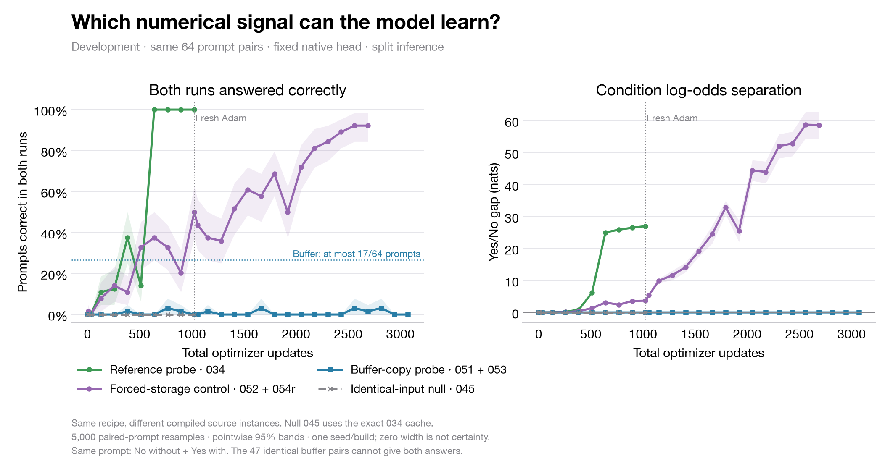

# Comparing learning from four numerical input conditions



[PDF](development.pdf) · [SVG](development.svg) · [Source hashes and statistics](development.json)

All curves use the same 64 development prompt pairs and the same initial 1,024-update recipe: native Qwen3-8B last two blocks and final norm, frozen existing output matrix, paired full-vocabulary cross-entropy, eight prompt pairs per update. The left panel requires **both full-vocabulary top-token answers** to be correct for a prompt. It is not individual-answer accuracy or forced-binary accuracy. The right panel measures the paired Yes/No log-odds difference.

The reference probe exposes a query-norm activation as a graph output. The buffer-copy probe writes the activation into a preallocated buffer; it leaves a numerical footprint for some prompts in this source build. The **forced-storage control** uses an opaque identity operation: it is a mechanism intervention, not a read-only probe or a zero-signal null. The identical-input null uses each 034 absent cached state for both contradictory labels, so both-correct accuracy and separation must be zero.

The four runs share prompts and training settings, but their historical compiled source instances differ. Only the 034/045 reference/null comparison uses the exact same original source cache. These curves do not isolate probe implementation from compilation-instance effects, or estimate variation across seeds or builds.

The blue dotted ceiling follows from 47 of 64 development buffer input pairs being byte-identical: a deterministic model cannot answer both labels correctly for those pairs. The remaining 17 pairs allow at most 26.5625% both-correct accuracy for this fixed cohort/cache. This is not a bound on other buffer implementations or compiler builds.

Bands are pointwise percentile intervals from 5,000 resamples of whole prompt pairs. They describe prompt variation conditional on each single run; all-correct samples give zero-width empirical intervals without population certainty. Test scores are not used in this figure. No checkpoint is selected from these curves.

Reproduce with `PYTHONPATH=src python scripts/plot_viewing_comparison.py`. The `--split train` option writes the training comparison if a separate `--out` stem is supplied. Original 034 scores record full-vocabulary argmax correctness without explicit top-token IDs; later archives include those IDs and the generator verifies them. Existing user figures are unchanged.

## Continuation updates

The blue and purple curves now include published intermediate 053 and 054r scores after the original 051/052 endpoints. The failed 054 provisioning attempt is not plotted. The total-step axis continues from 1,024; the vertical marker indicates fresh Adam moments, while weights, cached states, learning rate, prompt order and the frozen head continue. The gray and green historical curves end at 1,024 and are not extrapolated. These are still cached-tail split-inference results, not new compiled whole-model transfer measurements.

Rebuild the continuation figure with:

```bash
PYTHONPATH=src python scripts/plot_viewing_comparison.py \
  --buffer-continuation results/viewing-continuation-053-054/buffer/fit \
  --storage-continuation results/viewing-continuation-053-054/identity054r/fit
```

Intermediate raw scores and hashes are included in those archives. Each continuation passed exact baseline replay before its first optimizer update. Earlier snapshot manifests are retained by SHA-256 under each arm’s `snapshots/` directory.

The current snapshot includes the completed buffer endpoint at global step 3,072 and forced storage through global step 2,688. Buffer ends at 0.0% both-correct development accuracy, with a 0.001099-nat gap. Forced storage currently reaches 92.19% both-correct accuracy and a 58.64-nat gap. All earlier fluctuations remain plotted. The continuation is not selected or stopped based on this intermediate result; test scores are not plotted. Per-condition readouts are included in the figure JSON.
