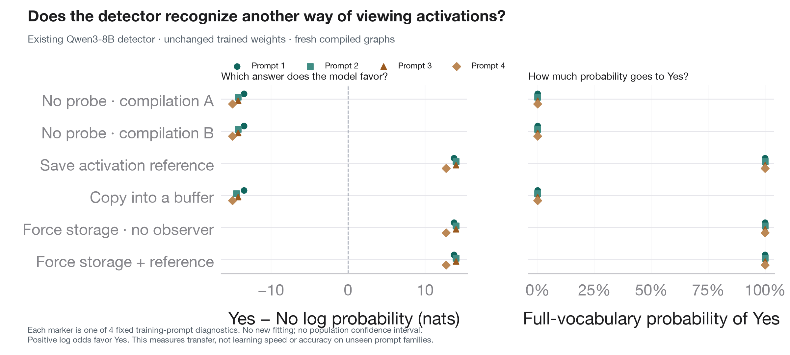

# Existing detector transfer across viewing controls049

**The existing034 detector strongly answers No for two independently compiled unprobed graphs and a verified buffer-copy read, but Yes for a reference probe and for opaque materialization without retaining an activation reference. No retraining occurred.** This distinguishes the learned numerical signal from reading itself on these four diagnostic prompts.



The figure shows every prompt, native Yes-minus-No log probability, and full-vocabulary Yes probability. These are four fixed detection **training-prompt diagnostics** from validation_v2, not a new held-out benchmark or an estimate of population accuracy. No confidence interval is inferred from deterministic repeats.

| Mode | Native Yes−No log odds for prompts0–3 (nats) | Greedy answers |
|---|---|---|
|No probe A|−13.5, −14.25, −14.25, −15|No, No, No, No|
|No probe B|−13.5, −14.25, −14.25, −15|No, No, No, No|
|Reference probe|+13.75, +14, +14, +12.75|Yes, Yes, Yes, Yes|
|Buffer-copy read|−13.5, −14.5, −14.25, −15|No, No, No, No|
|Opaque materialization|+13.75, +14, +14, +12.75|Yes, Yes, Yes, Yes|
|Materialization + reference|+13.75, +14, +14, +12.75|Yes, Yes, Yes, Yes|

Full-vocabulary Yes probability is at least0.9999971 for reference/materialization, and at most0.000001371 for either unprobed graph or buffer-copy read. These probabilities are native output probabilities, not normalized over only Yes and No. [Raw trained readouts](trained_answer_readouts.json), [base readouts](base_answer_readouts.json).

## What was held fixed

Original Qwen3-8B, pinned model revision, BF16 singleton96, six separate entrypoint code objects sharing one model. First compile and evaluate all six base-model conditions. Then validate and install the already released034 native last-two-block weights and norm **into that same model and the same compiled graphs**. No optimizer, fitting, added head, or new checkpoint selection. Native source requires_grad flags remain unchanged and execution is eval/no_grad. Scientific source `6979c8e427d5f95de2cf2f4f75c9b4c609dcc7b8`. [Protocol](../../experiments/compiler-storage-controls.md), [manifest](manifest.json), [checkpoint-transfer gates](trained_transfer.json).

Every graph repeats exactly. Passive observers preserve full-vocabulary outputs; final generated-wrapper identities and compiler counters remain unchanged. Installing the trained tail visibly changes native outputs. The released034 checkpoint hash and fixed native head digest were checked before installation. This tests transfer to fresh compilations; it does not assert bitwise recreation of034's historical execution.

## The controls actually executed

The buffer was poisoned with NaNs before each call, completely overwritten with finite values, exactly repeatable, and changed across distinct prompts. An observer verified that an executing generated Triton store targets the actual preallocated buffer. Its eager output also exactly matched a retained native activation. [Writer provenance](buffer_writers.json); complete captured tensors are in the release.

The opaque operation clones the query-norm tensor without arithmetic changes and returns the stored value to the model. Its fake implementation preserves shape/dtype; fullgraph tracing and tiny-model eager equivalence were tested. Identity+reference additionally retains that same stored value.

**Materialization versus materialization+reference has bit-identical full-vocabulary logits on all four prompts, both before and after trained-tail installation.** Reference versus materialization agrees on full logits for three prompts; prompt0 differs despite identical Yes/No probabilities. This supports materialization as a useful mechanism mimic, without claiming every generated kernel matches.

**Buffer-copy is not globally bit-invisible in this compilation set.** It matches unprobedB only on prompt0; the other three prompts differ in many vocabulary logits. Nevertheless, the trained reader consistently answers No. Likewise, unprobedA/B differ in full logits on prompt0 while giving the same Yes/No probabilities. The learned response is more specific than “any numerical difference.” [Additional full-logit comparisons](additional_logit_comparisons.json).

## Reproduce and artifacts

[artifact_manifest.json](artifact_manifest.json) records SHA256 and byte counts for every original output. Compact JSON and flushed events are checked in. The public release linked by [release.json](release.json) contains all full-vocabulary logits, captured buffer activations, generated wrappers and kernel metadata. It does not duplicate the already published034 weights.

After unpacking the release:

```sh
PYTHONPATH=src python scripts/analyze_viewing_transfer.py /path/to/control /tmp/comparisons.json
PYTHONPATH=src python scripts/plot_viewing_transfer.py results/viewing-transfer-049 /tmp/transfer
```

The analysis verifies every archived answer score against saved native logits using pinned-tokenizer No2753/Yes9454 IDs, then recomputes the additional comparisons. Log scores and token IDs must match exactly; derived probabilities allow one FP32 ULP for CPU `exp` differences (one base-model value differs by4.55e−13 between the worker and local build). This postprocessing allowance does not relax any model-logit parity gate.

Scientific execution took251seconds; the worker command took338seconds including setup. Total cost was **$0.1065**, including a discarded host. Both pods were confirmed deleted and the exact temporary approval removed. No further GPU run was launched as part of this archive.
